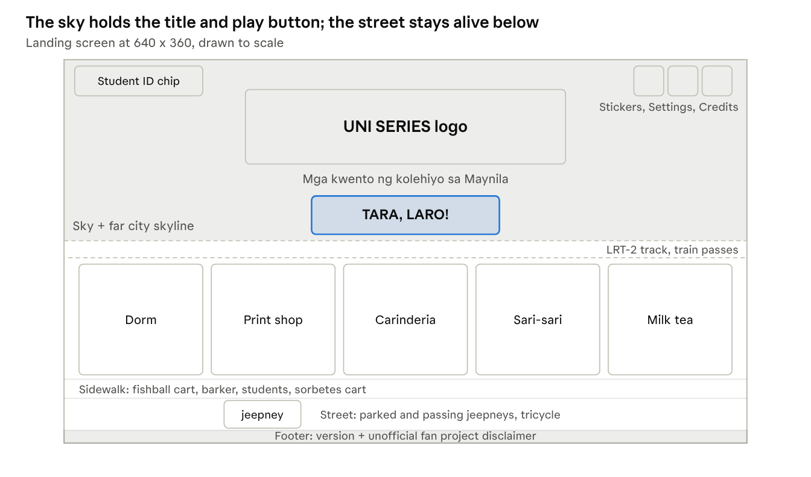

# Uni Series Homepage & Campus Map — Build Prompt

> **Status: DRAFT — not final.** Transcribed from the owner's PDF *"Uni Series Homepage & Campus Map — Build Prompt"*
> (Nov 20, 2026, @zeke; revised copy received 2026-11-22, which adds the landing wireframe, the embedded map and the
> two passages in §3.1 and §4.7). For the landing and map screens this doc wins over [SPEC.md](SPEC.md). It replaces SPEC.md's
> Title and Hub screens. "Changed" notes mark what later owner decisions altered (see
> [SPEC-pup-lagoon.md](SPEC-pup-lagoon.md) section 0 and [DECISIONS.md](DECISIONS.md)). The original text stays below each note.

---

## 1. Your task

You are a senior game developer with a strong eye for pixel-art UI. Build the homepage of **Uni Series**, a cozy 2D
browser game of short minigames inspired by universities in Manila's University Belt and PUP Sta. Mesa. The homepage has
two screens:

1. **Landing screen ("Tara, laro!")**: a living 2D street scene of Pinoy college life in Maynila, with the game title and the main buttons.
2. **Campus map menu ("Mapa ng U-Belt")**: an illustrated map of the U-Belt where each university is a stop. The player
   picks a campus and rides a jeepney there to start its minigame.

This comes before the PUP minigame (Lagoon Merienda). Tapping the PUP stop must open that minigame's intro, or a
placeholder scene if it is not built yet.

**Read first**

- `SPEC.md`: sections 2 (pillars), 3 (structure), 6 (art and audio), 7 (stack), 8 (architecture), 9 (save and settings)
  and 13 (legal). For the landing and map screens, this prompt wins over `SPEC.md`.
- `SPEC-pup-lagoon.md`: the PUP minigame's name, tagline and id (`pup-lagoon`).
- The attached U-Belt map image: the layout reference for the campus map (`docs/reference/ubelt-map.webp`, local only).

**In scope:** Boot and Preloader polish, the Landing screen, the transition into the map, the Campus Map with all 7
stops, campus info cards, a list view of all minigames, the top bar, and hooks for Settings, Sticker Book and Photo Album.

**Out of scope:** the minigames themselves, accounts, online features.

**How to build it**

- If you are inside the Uni Series project (`SPEC.md` is in the folder), build these as Phaser 4 scenes in that project.
  If the project does not exist yet, first complete milestone M0 from `SPEC.md`.
- If you cannot run a project (for example, in a chat without file tools), build a single self-contained HTML file that
  loads Phaser 4 from a CDN, with placeholder art, so I can preview the look and the flow.
- Work in the steps of section 9. Use placeholder shapes first, then art. Stop after each step and report.
- Ask me before adding any dependency not listed in `SPEC.md`.
- Put every player-facing word in the i18n files, using the keys given in this prompt.

## 2. Look and feel: Pinoy college life sa Maynila

The homepage should feel like walking out of class at golden hour in the U-Belt: warm orange sky, jeepneys honking, the
LRT-2 rumbling overhead, print shops and food carts everywhere, and students heading to their tambayan. Cozy, nostalgic
and funny, never gritty.

**Rendering**

- Pixel art at 640×360 base resolution, scaled with Phaser `FIT`, `pixelArt: true`, `roundPixels: true` (same as `SPEC.md`).
- Side-view street scene for the landing screen; top-down illustrated map for the campus menu.
- Soft outlines, warm light, long shadows. Lights in windows and signs flicker on as the scene sits.

**Pinoy college-life motifs** (use most of these; each is a small, tasteful detail)

| Motif | How it appears |
|---|---|
| Jeepneys | Colourful hand-painted sides, chrome trim, a horse hood ornament, route signboards such as "RECTO – STA. MESA" and "ESPAÑA – QUIAPO" |
| Barker | A man by the jeepney stop calling "Sta. Mesa! Isa na lang!" in a speech bubble |
| LRT-2 | Elevated concrete track across the scene; a train with a purple stripe glides by every 20–30 s |
| Print shop | Sign: "PRINT • XEROX • BIND • LAMINATE", a student holding a thick thesis |
| Dorm | Window sign: "BEDSPACE FOR RENT – WIFI READY", laundry hanging on a balcony |
| Carinderia and sari-sari store | Turo-turo food trays, snack sachets hanging in strips, a "Bawal ang utang" sign joke |
| Street food | Fishball cart with steam; a sorbetes (ice cream) cart with a bell |
| Tarpaulin | "CONGRATULATIONS, NEW BOARD PASSERS!" banner on a wall (no real names) |
| Wires and buntings | Tangled overhead electric wires, colourful banderitas (string flags) |
| Students | ID laces, backpacks, white polo uniforms, umbrellas used against the sun, folders, drafting tubes, nursing whites |
| Tricycle and pedicab | Parked by the corner, a driver napping |
| Pusa at aso | A street cat on a jeepney roof, a dog sleeping under a cart |

**Seasonal touch:** in December (from the device clock), parols hang from the wires and the music adds a soft Christmas jingle.

**Palette** (adjust by eye; shared ink and cream from `SPEC.md`)

| Use | Hex |
|---|---|
| Golden-hour sky, top to bottom | `#7A5BA6` → `#F07F6B` → `#FFB36B` |
| Distant city silhouettes | `#5B4A7A` |
| Building walls | `#E8D3B0`, `#C9A27E`, `#9DB4C0` |
| Jeepney colours | red `#D94B3D`, yellow `#F2C14E`, blue `#3B6FB6`, green `#3A9A6A`, chrome `#C9D1D9` |
| LRT-2 stripe and map line | `#7B4BB3` |
| Window glow and sign lights | `#FFE08A` |
| UI cream / ink | `#FFF4DC` / `#2B2233` |

**Typography**

- Title logo: "UNI SERIES" in an original hand-lettered jeepney sign-painter style: bold, slightly curved, chrome
  highlight, red and yellow outline, drop shadow. Draw it as an image (`logo_uniseries`), not live text.
- UI text: Pixelify Sans, as in `SPEC.md`.
- Signboards (jeepney routes, stop names on the map): a condensed, all-caps pixel style on a white or yellow board.

**Voice and copy**

Short, warm Taglish, like a friend texting you after class. Examples: "Tara, laro!", "Saan tayo ngayon?", "Sakay na!",
"Malapit na!", "Para po!" (when the jeepney arrives).

## 3. Screen 1: the landing page

One living street corner in the U-Belt at golden hour, seen from the side. The title and the big "TARA, LARO!" button sit
in the open sky; the city moves gently below. Scene key: `LandingScene`.

### 3.1 Layout (640×360 base)

All interactive UI sits in the open sky, so the busy street never hides a button. Layers and motion are in the table below.



*(Builder note: the wireframe matches the §3.2 positions to within a pixel. It draws the street from 318 to 348, with the
footer strip covering 348–360.)*

| Layer (back to front) | y range | Contents | Motion |
|---|---|---|---|
| Sky | 0–186 | Gradient, low sun on the right, 3 cloud sprites | Clouds drift left at 4 px/s |
| Far city | 120–186 | Generic Manila skyline silhouettes, a water tank, a church dome shape | Idle drift ±2 px |
| LRT-2 track | 170–186 (pillars down to 318) | Concrete elevated track across the full width | A train crosses left to right every 20–30 s in 2.5 s; its shadow flickers on the street |
| Shop row | 186–300 | From left: dorm (bedspace sign, laundry), print shop, carinderia, sari-sari store, milk tea stall; tangled wires with banderitas along the roof line | Signs and windows switch on one by one; banderitas sway |
| Sidewalk | 300–318 | Fishball cart (left), jeepney stop sign with the barker (centre-left), sorbetes cart (right), walking students | A student spawns every 2–4 s, walking either way |
| Street | 318–360 | One jeepney parked at the stop (its signboard cycles routes), passing jeepneys, a parked tricycle | A jeepney passes every 6–10 s |
| UI | over the sky | See 3.2 | |

### 3.2 UI elements

> **Changed (builder, DECISIONS.md H-001):** the top-right icons as written are 32 px apart, which cannot meet the 44 px
> phone touch target. H5 re-spaces them (44 px hit areas, for example x 508, 556, 604).

| Element | Position (centre) | Size | Behaviour |
|---|---|---|---|
| Logo "UNI SERIES" | 320, 63 | about 300×70 | Bobs ±2 px every 3 s; a chrome shine sweeps across every 6 s |
| Subtitle | 320, 112 | text | "Mga kwento ng kolehiyo sa Maynila" (`landing.subtitle`) |
| TARA, LARO! button | 320, 146 | 176×36 | Looks like a yellow jeepney route board with red letters; pulses softly; opens the campus map |
| Top-right icons | x 548, 580, 612; y 20 | 28×28 each | Sticker Book, Settings (gear), Credits (i) |
| Student ID chip | 70, 20 | 120×28 | After the ID is made: mini avatar + name; tap to edit |
| Footer strip | 0, 348 | 640×12 | Dark translucent strip: version on the left; "Unofficial fan project. Not affiliated with any university." centred (8 px text) |

### 3.3 First launch

> **Deferred by the owner (DECISIONS.md Q-003):** lace colours here are free, but the Lagoon Ipon Shop sells them, and
> the Lagoon player has a backpack colour this list lacks. H1 builds the ID maker as written below.

1. **Tap to start:** the scene is dimmed with "Pindutin para magsimula" (`landing.tapToStart`). The first tap unlocks
   audio, then the scene brightens and the logo drops in with a bounce.
2. **Gawa ng School ID:** the first time the player taps TARA, LARO!, an ID card slides up: pixel avatar preview, name
   field (max 12 characters), skin tone (6), hair (8), outfit (4), ID lace colour (6), and "Ayos na!" to save. This same
   avatar is used in every minigame.
3. Returning players skip both; the landing shows "Welcome back, {name}!" (`landing.welcomeBack`) for 2 seconds.

### 3.4 Time of day

The scene follows the device clock (Settings → Theme: Auto or Golden hour only):

| Device time | Look | Swaps |
|---|---|---|
| 6:00–10:59 | Umaga: pale blue sky, soft light | Taho vendor replaces the sorbetes cart; students carry coffee |
| 11:00–14:59 | Tanghali: bright, short shadows | Students hold umbrellas against the sun |
| 15:00–18:29 | Hapon: golden hour (default look) | Signs start switching on |
| 18:30–5:59 | Gabi: navy sky, stars, glowing signs | The LRT train has lit windows; fewer students; a cat sleeps under the streetlight |

### 3.5 Tappable surprises

Each reacts once, then has a 5-second cooldown. They are optional fun, never required.

| Tap | Reaction |
|---|---|
| Parked jeepney | Horn "beep-beep", the barker shouts a random route |
| Sorbetes cart | Bell "kling-kling", a tiny ice cream pops up |
| Print shop | Printer whirr, a few papers flutter out |
| Cat on the roof | "Meow", a heart |
| LRT train | Chime, windows flash |
| Barker | Speech bubble: "Sta. Mesa! Isa na lang!" or "España! Kasya pa!" |

## 4. Screen 2: the U-Belt campus map menu

An illustrated, hand-drawn-style map of the U-Belt and Sta. Mesa, traced loosely from the attached reference map. Each
university is a stop; the player's jeepney drives between them. Scene key: `CampusMapScene` (it replaces `HubScene` in `SPEC.md`).

### 4.1 Map look

- Top-down view, like a friendly tourist map: soft paper texture at the edges, rounded city blocks, warm tint matching the
  landing screen's time of day.
- Roads to draw and label (signboard style): España Blvd. (upper diagonal), Recto Ave. (left, under the LRT-2), Legarda,
  Mendiola, Morayta (by FEU), Magsaysay Blvd. (toward Sta. Mesa).
- LRT-2: a purple dashed line from left to right with station dots labelled Recto, Legarda and Pureza.
- Pasig River along the bottom with its creeks, in soft blue with a gentle shimmer.
- Campus blocks: each stop's block is highlighted in a soft accent colour with an original illustrated building
  silhouette (no logos or seals; see section 10).
- Ambient: the LRT-2 train runs along its line every 20–30 s; 2–3 small jeepneys follow road paths; cloud shadows drift; birds cross.

### 4.2 Stops

Positions are centres on the 640×360 map (adjust by eye against the reference). The jeepney route links the stops in this order.

| Order | Campus | Area | x, y | Minigame | Status |
|---|---|---|---|---|---|
| 1 | UST | España | 190, 75 | Paskuhan Lights | Soon |
| 2 | FEU | Morayta | 135, 167 | Deco Restore | Soon |
| 3 | NU | Sampaloc | 272, 159 | Pep Rally | Soon |
| 4 | UE | Recto | 245, 218 | Recto Book Hunt | Soon |
| 5 | San Beda | Mendiola | 300, 236 | Shootaround sa Mendiola | Soon |
| 6 | CEU | Mendiola | 380, 232 | Compounding Lab | Soon |
| 7 | PUP | Sta. Mesa | 555, 248 | Lagoon Merienda | Playable |

**Stop marker** (one per campus)

> **Changed (OC-12):** Lagoon Merienda is endless with no stars. The playable pin shows that minigame's own progress
> summary (for PUP, the ipon total, for example "₱240") instead of "★ 12/60".

- A round pin (24×24) with the campus short name on a small signboard below it.
- Playable: full colour, a gentle bounce every 2 s, a star counter under the sign ("★ 12/60"), and a sticker icon once earned.
- Soon: greyscale with a small tarpaulin that reads "SOON".
- Hover (desktop) or first tap (touch): the pin grows 10% and the block glows.

### 4.3 Campus card

> **Changed (OC-12):** "Progress" shows vacants played, ipon and the sticker for PUP, not stars and days cleared.

Tapping a stop zooms the camera 10% toward it (300 ms) and slides a campus card up from the bottom (360×150, centred).

| Part | Content |
|---|---|
| Left | 96×96 illustration of the campus scene (for PUP: the Lagoon with stalls) |
| Title area | Campus name ("PUP Sta. Mesa"), minigame title ("Lagoon Merienda"), tagline ("Busog na, may ipon pa!") |
| Progress | Stars, days cleared, sticker status (playable only) |
| Buttons | Sakay na! (ride there and play) and Isara (close). For Soon stops: "Malapit na!" with a one-line teaser and a disabled "Abangan!" button |

### 4.4 Riding the jeepney

1. Tap Sakay na! The card slides away.
2. The player's jeepney drives along the route polyline from its current stop to the chosen one at 120 px/s (minimum
   1.2 s, maximum 3 s). Its signboard shows the destination, for example "STA. MESA".
3. On arrival: a "Para po!" bubble, a little brake bounce, then a fade into the minigame's intro scene.
4. A Skip button appears after 0.5 s. With Reduced Motion on, skip the ride and just fade.
5. The jeepney stays at that stop for the next visit to the map.

### 4.5 List view ("Listahan ng Laro")

A toggle at the top-left switches between Mapa and Listahan. The list shows all 7 minigames as signboard-style cards
(560×64): campus, minigame title, status pill ("Laro na!" or "Soon"), stars. Tapping a card opens the same campus card.
This view is the accessible, no-map way to pick a game. *(OC-12: "stars" becomes the minigame's progress summary.)*

### 4.6 Map HUD

> **Changed (builder, DECISIONS.md H-001):** Home (20, 20), the toggle (64, 20) and the ID chip (160, 20) overlap as
> written. H5 lays them out left to right with 44 px hit areas.

| Element | Position | Notes |
|---|---|---|
| Home button | top-left (20, 20) | Back to the landing screen |
| Mapa / Listahan toggle | (64, 20) | Two-state pill |
| Student ID chip | (160, 20) | Avatar + name |
| Ipon total | top-right (480, 20) | Sum of all savings, with a small alkansya icon |
| Sticker count | (560, 20) | "1/7" |
| Settings | (612, 20) | Gear |
| Sticker Book | bottom-left (28, 334) | Book icon |
| Album | bottom-right (612, 334) | Photo icon |
| Map credit | bottom centre, 8 px | "Map data © OpenStreetMap contributors" |

### 4.7 Reference map (from the game owner)

Use it for the relative positions of campuses, the LRT-2 line, the main roads and the river. Redraw it in the warm
illustrated style of section 2; do not copy its dark colours.

Saved locally as `docs/reference/ubelt-map.webp` (gitignored; see `docs/reference/README.md`). It shows España (top),
UST as a large diamond top-left, FEU and Recto on the left, NU in the middle, UE / San Beda · CEU along the dashed
purple LRT-2 line, the Pasig River across the bottom, and PUP on the right, east of the creeks.

## 5. Minigame roster data

The map, list view and campus cards all read from one data file, so adding a campus later means adding one entry. Use
this as the starting content of `src/minigames/roster.ts` (it extends the `MinigameManifest` in `SPEC.md` section 5).

```ts
export const ROSTER: RosterEntry[] = [
  { id: 'ust-paskuhan', campus: 'UST', area: 'España', stop: 1, x: 190, y: 75,
    title: 'Paskuhan Lights', status: 'soon',
    tagline: 'Sindihan ang campus bago ang fireworks!',
    teaser: 'Connect the parol lights before the Christmas show.' },
  { id: 'feu-deco', campus: 'FEU', area: 'Morayta', stop: 2, x: 135, y: 167,
    title: 'Deco Restore', status: 'soon',
    tagline: 'Ibalik ang ganda ng Art Deco.',
    teaser: 'A relaxing puzzle: restore a faded Art Deco façade.' },
  { id: 'nu-peprally', campus: 'NU', area: 'Sampaloc', stop: 3, x: 272, y: 159,
    title: 'Pep Rally', status: 'soon',
    tagline: 'Isa pa! Lakasan ang cheer!',
    teaser: 'Tap to the drumbeat and keep the crowd hyped.' },
  { id: 'ue-bookhunt', campus: 'UE', area: 'Recto', stop: 4, x: 245, y: 218,
    title: 'Recto Book Hunt', status: 'soon',
    tagline: 'Hanapin ang libro sa listahan.',
    teaser: 'Search the bookstall shelves for every book on the list.' },
  { id: 'sanbeda-shoot', campus: 'San Beda', area: 'Mendiola', stop: 5, x: 300, y: 236,
    title: 'Shootaround sa Mendiola', status: 'soon',
    tagline: 'Isang tira pa bago umuwi.',
    teaser: 'Chill free throws after class; time your release.' },
  { id: 'ceu-lab', campus: 'CEU', area: 'Mendiola', stop: 6, x: 380, y: 232,
    title: 'Compounding Lab', status: 'soon',
    tagline: 'Sukat, halo, ayos!',
    teaser: 'Measure and mix orders in the pharmacy lab.' },
  { id: 'pup-lagoon', campus: 'PUP', area: 'Sta. Mesa', stop: 7, x: 555, y: 248,
    title: 'Lagoon Merienda', status: 'playable',
    tagline: 'Busog na, may ipon pa!',
    teaser: 'Stretch your baon across the Lagoon stalls.',
    introScene: 'LagoonIntroScene' },
];
```

**Rules**

- Titles, taglines and teasers go through i18n (`roster.<id>.title`, `.tagline`, `.teaser`); the strings above are the English/Taglish defaults.
- Progress (stars, days cleared, sticker) comes from the save file, never from this list. *(OC-12: each minigame's own progress summary.)*
- If `introScene` does not exist yet, launch a placeholder scene that says "Ginagawa pa 'to!" with a Back button.
- The non-PUP titles are working titles and may change; keep them in data, not in code.

## 6. Transitions, audio, settings and accessibility

**Transitions**

| From → to | What happens | Time |
|---|---|---|
| Boot → Preloader | Loading bar is a road; a tiny jeepney drives along it; its signboard shows the percent; text "Sumasakay na…" | as long as loading takes |
| Preloader → Landing | Fade from ink colour | 400 ms |
| Landing → Map | The parked jeepney pulls away to the right, then the map unfolds like paper (scale 0.92 → 1, fade in) | 800 ms + 400 ms |
| Map → Minigame | The jeepney ride from section 4.4, then fade | 1.2–3 s + 400 ms |
| Minigame → Map | Fade in with the jeepney at that stop; a toast shows new stars ("+3 ★ sa PUP!") *(OC-12: "+₱25 sa alkansya!")* | 400 ms |
| Map → Landing | Reverse fade | 400 ms |

**Audio**

| Key | What it is |
|---|---|
| `music_landing` | Lo-fi, OPM-inspired original loop: acoustic guitar, soft keys, light beat (90–120 s) |
| `music_map` | Lighter travel tune: ukulele, whistle, shaker |
| `amb_street_day` | Traffic hum, distant horns, chatter, birds |
| `amb_street_night` | Crickets, far-off traffic, a very faint videoke song in the distance (original melody, no lyrics) |
| `sfx_jeep_horn`, `sfx_jeep_engine`, `sfx_brake` | Jeepney sounds |
| `sfx_lrt_pass`, `sfx_lrt_chime` | Train rumble and station chime |
| `sfx_sorbetes_bell`, `sfx_printer`, `sfx_meow` | Tappable surprises |
| `sfx_click`, `sfx_paper_unfold`, `sfx_card_slide` | UI |
| `vox_barker`, `vox_para` | Short voice blips, no real words recorded |

Music and ambience cross-fade over 600 ms between screens. Night uses the same music with a gentle low-pass filter.

**Settings additions** (everything else as in `SPEC.md` section 9)

- Theme: Auto (follows the device clock) or Golden hour (always hapon).
- Map view: remember Mapa or Listahan between visits.

**Accessibility**

- The list view lets players choose a game without reading the map.
- Keyboard: on the map, arrow keys move between stops in route order, Enter opens the card, Esc closes it, Tab switches
  Mapa/Listahan. On the landing, Enter = TARA, LARO!
- Reduced Motion: no idle drift, no logo bob, no camera zoom, the jeepney ride becomes a fade.
- All buttons sit on solid boards or panels, so text never sits directly on the busy scene. The logo has a thick outline.
- Touch targets at least 44×44 px on phones. Tappable surprises are never required.
- When the tab is hidden, stop spawning walkers and vehicles and mute audio.

## 7. Technical build instructions

Use the stack and conventions in `SPEC.md` (Phaser 4 + TypeScript strict + Vite, logic separate from views, tuning in
config files). Phaser examples online are mostly Phaser 3; when an API fails, check the Phaser 4 migration guide before guessing.

**Scenes**

| Scene key | Type | Purpose |
|---|---|---|
| `BootScene` | normal | Loads the loading-bar assets |
| `PreloaderScene` | normal | Jeepney loading bar, fonts, shared atlas, audio |
| `LandingScene` | normal | Section 3 |
| `IdCardScene` | overlay | First-launch School ID maker; also opened from the ID chip |
| `CampusMapScene` | normal | Section 4, including the campus card and list view as UI containers |
| `SettingsScene`, `StickerBookScene`, `AlbumScene` | overlay | Hooks; Sticker Book and Album may show "Malapit na!" for now |
| `ComingSoonScene` | normal | Placeholder for any minigame whose intro scene does not exist yet |

**Files**

```
src/
├─ home/
│  ├─ config.ts         spawn rates, speeds, timings, colours, positions from sections 3–4
│  ├─ TimeOfDay.ts      pure: device time -> 'umaga' | 'tanghali' | 'hapon' | 'gabi'
│  ├─ StreetSpawner.ts  pooled walkers, jeepneys, LRT train on the landing
│  ├─ Surprises.ts      tappable reactions with cooldowns
│  └─ IdCard.ts         avatar parts and validation
├─ map/
│  ├─ RoutePath.ts      pure: polyline length, point at distance, path between two stops
│  ├─ StopMarker.ts     pin + sign + stars + states
│  ├─ CampusCard.ts     slide-up card
│  ├─ ListView.ts       scrollable signboard cards
│  └─ JeepneyRide.ts    ride animation along RoutePath
├─ minigames/roster.ts  section 5 data
└─ scenes/              the scenes above
```

**Save additions** (extend `SaveData` from `SPEC.md` section 9; bump the version and add a migration)

> **Changed (builder, DECISIONS.md D-016):** no player has a save yet, so these go straight into save version 1 with no migration.

```ts
profile?: { name: string; skin: number; hair: number; outfit: number; lace: number };
home: { lastStop: number; mapView: 'map' | 'list'; theme: 'auto' | 'golden' };
```

**Rules**

- `TimeOfDay` and `RoutePath` have no Phaser imports and get unit tests (phase boundaries at 6:00, 11:00, 15:00, 18:30;
  path lengths; ride from stop 7 to stop 1 and back).
- Add a roster test: unique ids, stops 1–7, positions inside 640×360, exactly one playable entry for now.
- Pool all walkers, vehicles and floating bubbles. On-screen caps: 6 walkers, 2 moving jeepneys, 1 train.
- Use fixed depth constants per layer (sky 0, city 10, track 20, shops 30, sidewalk 40, street 50, UI 100).
- No `setTimeout`; use `scene.time` so pausing and hidden tabs work.
- Pack landing and map art into one atlas (`home.png` + `home.json`), plus the map base image. Load minigame assets only
  when entering a minigame.
- Budgets: homepage downloads under 3 MB; 60 fps on desktop and at least 50 fps on a mid-range phone.

**i18n key groups:** `landing.*`, `id.*`, `map.*`, `roster.*`, `transition.*`. Use the Taglish strings given in this prompt as the defaults.

## 8. Asset list

Start with labelled placeholder shapes using these exact keys, so final art drops in without code changes. All art is
original pixel art. *(Made by Claude: DECISIONS.md R-006.)*

**Landing**

| Key | Type | Size (px) | Notes |
|---|---|---|---|
| `logo_uniseries` | image | ~300×70 | Jeepney sign-painter lettering, chrome shine as a separate overlay `logo_shine` |
| `sky_<phase>` | image | 640×186 | umaga, tanghali, hapon, gabi |
| `cloud_1..3`, `sun`, `moon`, `stars` | image | various | |
| `city_far_<phase>` | image | 640×66 | Generic skyline silhouettes |
| `lrt_track` | image | 640×16 + pillars | Elevated concrete track |
| `lrt_train` | spritesheet | 220×24, 2 frames | Purple stripe; lit windows at night |
| `shop_dorm`, `shop_print`, `shop_carinderia`, `shop_sarisari`, `shop_milktea` | spritesheet | ~120×114 each, 2 frames | Lights off / on |
| `wires_banderitas` | spritesheet | 640×40, 4 frames | Sway loop |
| `cart_fishball`, `cart_sorbetes`, `cart_taho` | spritesheet | 40×32, 2–4 frames | Steam, bell wiggle |
| `barker` | spritesheet | 16×24, 4 frames | Waving and calling |
| `walker_1..6` | spritesheet | 16×24, walk 4 frames | Students with ID laces, umbrellas, folders, drafting tube, nursing whites |
| `jeep_1..4` | spritesheet | 72×40, drive 2 frames + idle | Four colour schemes; signboard as a separate text sprite |
| `tricycle`, `cat`, `dog` | spritesheet | 40×32, 16×12, 20×12 | Idle loops |
| `tarp_board_passers` | image | 96×32 | Generic congratulations banner |
| `btn_signboard` | nine-slice | 24×24 source | Yellow route-board button |
| `icon_settings`, `icon_credits`, `icon_stickers`, `icon_album`, `icon_home`, `icon_map`, `icon_list`, `icon_close` | image | 24×24 | `icon_close`: School ID header X (DECISIONS D-055) |

**Map**

| Key | Type | Size (px) | Notes |
|---|---|---|---|
| `map_ubelt_<phase>` | image | 640×360 | Base map: blocks, roads, river, paper edge; tinted per time of day |
| `map_labels` | image | 640×360 (transparent) | Road names and station names |
| `map_campus_<id>` | image | ~64×48 each | Original building silhouettes for 7 campuses |
| `pin_playable`, `pin_soon` | spritesheet | 24×24, 4 frames | Bounce; greyscale version |
| `sign_stop` | nine-slice | — | Small signboard under each pin |
| `tarp_soon` | image | 28×14 | "SOON" tarpaulin |
| `map_jeep` | spritesheet | 24×16, 4 directions | Player jeepney on the map |
| `map_train` | image | 40×10 | LRT-2 train on the map |
| `card_bg`, `card_thumb_<id>` | nine-slice, image | 360×150, 96×96 | Campus card and its illustration |
| `list_card` | nine-slice | 560×64 | Signboard card for the list view |

**ID card**

| Key | Type | Size (px) | Notes |
|---|---|---|---|
| `id_card_bg` | image | 280×176 | Generic "Uni Series" student ID (no real school design) |
| `avatar_<part>_<n>` | spritesheet | 48×48 | Skin 6, hair 8, outfit 4, lace 6 |

Audio keys are listed in section 6. All audio ships as `.ogg` + `.m4a`.

## 9. Build steps, acceptance criteria and reporting

Build in five steps. After each one, run lint, tests and build, fix every error, commit, then stop and report to me
before continuing.

1. **H1 — Greybox flow.** All scenes from section 7 with coloured rectangles and labels at the section 3 and 4 positions.
   Landing → ID card (first launch) → map → campus card → ride → PUP intro or `ComingSoonScene` → back to map. Roster
   data, `RoutePath`, `TimeOfDay`, save additions and their unit tests.
2. **H2 — Living landing.** Layers, street spawner, LRT-2 train, tappable surprises, time-of-day phases, tap-to-start, logo animation, footer.
3. **H3 — Living map.** Map layers, stop markers with states, campus card, jeepney ride along the route, list view, map HUD, keyboard navigation.
4. **H4 — Art and audio pass.** Replace placeholders using the section 8 keys, music and ambience cross-fades, all SFX.
5. **H5 — Polish.** Transitions, Reduced Motion, phone layout and touch-target checks, performance pass, Filipino UI text.

**Acceptance criteria**

- A first-time player sees tap-to-start, makes a School ID, reaches the map and starts Lagoon Merienda in under 30
  seconds without help.
- A returning player skips the ID step and sees "Welcome back, {name}!".
- All 7 stops appear at their positions; only PUP is playable; Soon stops show their teaser card.
- The jeepney always follows the road route and ends exactly on the chosen stop; Skip and Reduced Motion work.
- List view and map view open the same campus cards; the choice is remembered.
- Time-of-day phases switch correctly from the device clock, and the Golden hour setting overrides them.
- Everything works with touch only, mouse only and keyboard only.
- 60 fps on desktop and at least 50 fps on a mid-range phone; homepage downloads under 3 MB.
- No console errors; all text comes from i18n; the disclaimer and map credit are visible.

**What to report after each step**

- What you built, as a short list.
- How I can test it, step by step, in the browser (and on my phone with `npm run dev -- --host`).
- Any decision you made that this prompt did not cover (also add it to `DECISIONS.md`).
- Screenshots or a short description of the landing and the map as they look now.

If you are stuck on the same error after 3 attempts, stop and explain it in plain words with two options.

## 10. Respectful-use rules

The homepage must feel like the real U-Belt without copying anyone's marks. These rules extend `SPEC.md` section 13.

- **No school logos, seals, mascots or team marks** anywhere: not on the map, the campus cards, the ID card or the
  buildings. Campus buildings are original, simplified silhouettes; school colours may appear only as soft accents.
- **No real business names or brands.** Shops are generic: "Print • Xerox • Bind", "Carinderia", "Milk Tea". No real
  fast-food, telecom, bank or drink brands on signs, cups or tarpaulins.
- **Transit stays generic.** Draw the LRT-2 as a train with a purple stripe, without the operator's logo. Jeepney art is
  original; route signboards use real place names only.
- **No real people.** The barker, vendors and students are original characters; tarpaulins never show real names or faces.
- **Map credit.** The map is traced from OpenStreetMap-based reference, so show "Map data © OpenStreetMap contributors"
  on the map and in Credits.
- **Keep the disclaimer** visible on the landing footer and in Credits: "Uni Series is an unofficial fan project. It is
  not affiliated with, endorsed by, or sponsored by any of the universities it references."
- **Humour stays affectionate.** Traffic, floods and petsa de peligro are shared jokes; never mock a school, its
  students, vendors or drivers.
