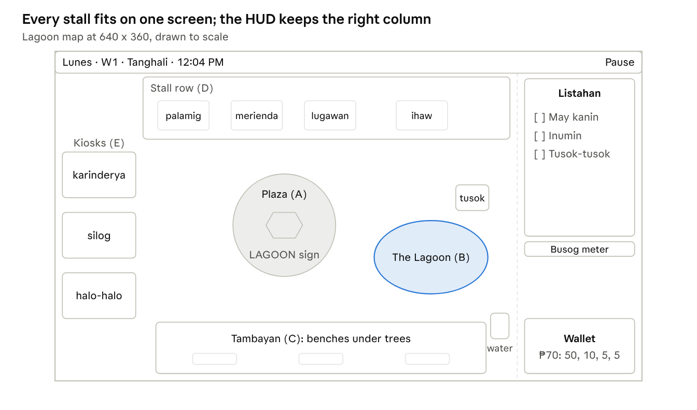

# Lafang sa Lagoon — PUP Lagoon Minigame Spec

> **Status: DRAFT — not final.** Transcribed from the owner's PDF *"Lafang sa Lagoon — PUP Lagoon Minigame Spec"*
> (Nov 20, 2026, @zeke). It replaces section 4 ("Merienda sa Lagoon") of [SPEC.md](SPEC.md).
> **Section 0 lists the owner's changes since the PDF. Section 0 wins over every other section of this file.**
> Sections it changes carry a "Changed" note at the top. The original text stays below each note for reference.
> Builder decisions are in [DECISIONS.md](DECISIONS.md).

---

## 0. Owner changes (2026-11-22) — these win

The owner decided: **no days, no day unlocking. Lafang sa Lagoon is an endless cozy game.** The builder worked out the
rules below from that decision and the rest of this spec. The owner can change any of them; record changes in DECISIONS.md.

**OC-1 — Endless vacants, no calendar.** No month, weeks, weekdays, day unlocking, campaign end or replaying days.
The game is an endless series of **vacants** (rounds). Each vacant has its own baon, time slot, listahan and maybe an
event. After Results, **"Isa pa!"** starts the next vacant and **"Balik sa mapa"** returns to the campus map. Progress
saves after every vacant. `LagoonIntroScene` shows the **Vacant card** (the old Day card) for the next vacant, with
Tara!, Ipon Shop, Album and Back buttons.

**OC-2 — No clock and no bell.** The round never times out. Walking and the pila stay for feel only. The
"May quiz pa!" event is removed. The Settings "Chill Mode" switch does not change this minigame. The **Smart pay**
button is always available, and paying coin by coin stays the default way to pay.

**OC-3 — No stars. Stamps instead.** Results show up to three stamps:

| Stamp | When |
|---|---|
| **Kumpleto!** | Every listahan line is ticked |
| **Busog!** | The busog meter reaches this vacant's target |
| **Sulit Master!** | Listahan complete, the player spent at most ₱5 more than the cheapest way to complete it, and no rule (like Bawal maanghang) was broken |

- The ipon goal is removed.
- **"Tara, kain na!"** is always available once the player has bought anything. With the listahan complete, leftover
  money drops into the alkansya as ipon. With it incomplete, the barkada says something kind ("Okay lang, next
  vacant ulit!") and the leftover goes home with you. Existing ipon is never lost.
- "Ano ang pinakasulit?" stays.

**OC-4 — Rhythm and difficulty by vacant count.** `n` = the number of the vacant being played (1, 2, 3, …).

| Vacants | Tier | Replaces | Stalls open |
|---|---|---|---|
| 1 | Tutorial | W1 Lunes | karinderya, tusok, palamig, ihaw |
| 2–5 | 1 | Week 1 | the same four |
| 6–12 | 2 | Week 2 | + merienda, lugawan |
| 13–20 | 3 | Week 3 | + halohalo, silog |
| 21 and up | 4 | Week 4 | all eight (endless from here) |

- Wherever this spec says "Week N", read "Tier N": listahan generation (§6), busog targets (§9.3), wallet mixes and events.
- New stalls are announced on the Vacant card. Their shutters fold open the first time the player sees the map.
- **Time slot** cycles umaga → tanghali → hapon from one vacant to the next. The tutorial is tanghali.
- **Baon** is drawn for each vacant (seeded) from weights in `config.ts`. Normal days are ₱60–₱80. From tier 2,
  **petsa de peligro** (₱50) comes up about 1 vacant in 6. From tier 3, **payday** (₱150, "Kinsenas na!" or
  "Katapusan na!" alternating) comes up about 1 vacant in 8. Never the same special twice in a row. Paydays add the
  Pang-barkada ×3 line and Jomar's "Libre mo kami!".
- From tier 2, about 1 vacant in 10 is a **walang-panukli vacant**: every "kaunti" stall starts with an empty cash box.

**OC-5 — Events.** From tier 2: at most one random event per vacant, about **40%** of vacants in total, and never the
same event twice in a row. Starting chances (tune in `config.ts`): rain 10%, hot day 8% (tier 3+), sold out 8%,
promo 8%, mahabang pila 6%.

**OC-6 — "Per day" becomes "per vacant".** Tumbler refill, Bea's sulit tip and petting Muning each work once per vacant.
Suki levels count distinct vacants (3 → Suki 1, 8 → Suki 2). The photo album gets a photo **every 5th vacant**
("Picture muna bago kumain!"), showing the favourite food of the last 5 vacants.

**OC-7 — Ipon and alkansya.** The alkansya shows the **current ipon balance**, which the Ipon Shop spends. The
"Basagin ang alkansya!" breaks count **lifetime ipon** (all ipon ever saved), so shopping never sets a break back:
₱200, ₱500 and ₱1,000, then one more break every ₱1,000 after that. Rewards are fixed and listed in `config.ts`. The
**PUP sticker** for the Sticker Book comes with the first break (₱200 lifetime).

**OC-8 — Generator.** The seed is `saveSeed + n`. Accept a listahan only if:
- the cheapest way to complete it (`minCost`) is at most the wallet (baon + pasabay + event bonus);
- `minCost` is at least half the baon;
- no single item ticks every line (except the tutorial);
- the cheapest way to complete it *and* reach the busog target (`minCostBusog`) also fits in the wallet.

If 200 tries fail, use the hand-made fallback lists for that tier in `data/fallbacks.ts`, which replaces `calendar.ts`.

**OC-9 — Worked example 3 corrected.** The cheapest way is **sago't gulaman ₱20 + pandesal ₱10 = ₱30, leftover ₱30**.
Gulaman ticks Malamig, Matamis and Inumin, and pandesal ticks Pang-merienda. Menu prices stay as they are. The worked
examples are now solver test cases.

**OC-10 — Milestones L4 and L5.** **L4 — One full vacant:** the Vacant card, "Tara, kain na!", kain scene, Results
with stamps, Sulit, "Ano ang pinakasulit?", the alkansya drop, "Isa pa!", and the tutorial vacant with a hand pointer.
**L5 — Endless loop and progression:** tiers, baon draws, wallet mixes, stall openings with the shutter animation,
events, pasabay, payday libre, suki levels, friendship hearts, Ipon Shop, alkansya breaks, photo album, PUP sticker
and saving. Done when a fresh save can play 30 vacants in a row, with every feature showing up, and progress survives
reload. `npm run sim` generates 40 vacants for each of 1,000 seeds, prints the numbers per tier, and reports zero
unsolvable vacants.

**OC-11 — Save section** (inside SPEC.md §9's save, version 1, since no player has a save yet):
```ts
lagoon: {
  vacants: number;                    // vacants finished
  saveSeed: number;
  iponBalance: number; iponLifetime: number; alkansyaBreaks: number;
  suki: Record<StallKey, number>;     // distinct vacants bought from
  hearts: Record<'migs' | 'bea' | 'jomar', number>;
  owned: string[];                    // Ipon Shop items
  album: { vacant: number; food: string }[];
  stamps: { kumpleto: number; busog: number; sulit: number };
}
```

**OC-12 — Campus map tie-ins** (SPEC-homepage.md). The PUP pin shows the ipon total (for example "₱240") instead of
"★ 12/60". The campus card shows vacants played, ipon and the sticker. The return toast says "+₱25 sa alkansya!"
instead of "+3 ★ sa PUP!". The map shows whatever progress summary each minigame provides.

**Deferred by the owner:** the ID lace conflict (free lace colours in the ID maker vs. ₱40 laces in the Ipon Shop,
and the backpack colour). See DECISIONS.md Q-003.

---

## 1. How to use this document

This spec defines the PUP Lagoon minigame, **Lafang sa Lagoon**. It replaces section 4 ("Merienda sa Lagoon") of the
main Uni Series spec. Everything else in the main spec still applies: the tech stack, architecture, save system,
settings, deployment and legal notes.

**For you (the human)**

1. Export this doc as Markdown and save it as `SPEC-pup-lagoon.md` next to the main `SPEC.md`.
2. Give the AI both files and paste the master prompt from section 16.
3. Build this minigame milestone by milestone (section 14), testing each in your browser.

**Rules for the AI builder**

- If this doc and SPEC.md disagree about the PUP Lagoon minigame, this doc wins. For everything else, SPEC.md wins.
- The minigame id stays `pup-lagoon`, and it uses the same folders, `config.ts`, logic/view split, save format and
  placeholder-first approach as SPEC.md section 8.
- Every price, budget, timer and probability lives in `src/minigames/pup-lagoon/config.ts` and the data files in section 13.
- Every generated round must be solvable within the baon. Use the solver in section 13, and never ship a listahan the
  player cannot finish.
- Keep all player-facing text in the i18n files. The Taglish lines in section 12 are part of the game's flavour; keep them as written.

**Filipino terms used in this spec** (the AI must use these words in-game as written)

| Term | Meaning |
|---|---|
| Baon | Daily allowance money a student brings to school |
| Listahan | A list; here, the list of cravings to buy |
| Sukli | Change given back after paying |
| Barya | Coins or small change |
| Walang panukli | "No change available": the vendor cannot give change |
| Alkansya | Piggy bank, traditionally made of bamboo |
| Ipon | Savings |
| Tusok-tusok | Street food you skewer yourself from a cart: fishball, kikiam, kwek-kwek |
| Ulam | Main dish eaten with rice |
| Kanin | Cooked rice |
| Sawsawan | Dipping sauce |
| Busog | Full, satisfied after eating |
| Pila | A queue or line |
| Suki | A regular customer who gets small favours |
| Pa-extra / dagdag | Asking for a little extra (more sauce, a bit more rice) |
| Pasabay | Asking a friend to buy something for you while they are out |
| Libre | Treating someone; paying for them |
| Barkada | Close group of friends |
| Petsa de peligro | "Danger dates": the days before payday when money is tight |
| Vacant | A free period between classes |
| Tambay | To hang out |

## 2. Concept at a glance

> **Changed (OC-1, OC-2, OC-3):** endless vacants, no campaign; no clock; stamps instead of stars.

**Pitch:** You have ₱70 baon and one vacant period. Your listahan says: something with rice, something cold, and
tusok-tusok. Walk around the Lagoon, compare the stalls, count your barya, and get everything on the list without going
over budget. Then sit under the trees and eat with your barkada.

| Item | Decision |
|---|---|
| Title | Lafang sa Lagoon ("lafang" is Filipino slang for food or eating). Tagline: "Busog na, may ipon pa!" |
| Minigame id | `pup-lagoon` |
| Genre | Cozy budgeting and shopping puzzle |
| Round | One vacant period: about 3 real minutes (10 game minutes) |
| Campaign | "Isang Buwan sa Lagoon": 4 weeks × 5 school days = 20 rounds, then endless Chill Mode |
| Player goal | Buy every craving on the listahan without going over the baon |
| Stars per day | ★ all cravings bought · ★ + busog meter full · ★ + ipon goal saved |
| Fail state | None. You can never overspend; a missed craving just means fewer stars |
| Controls | Tap or click only; keyboard optional |

**Design pillars for this minigame**

1. **Budgeting is the puzzle.** Every peso counts. The satisfying moment is finding the sulit (best value) combo, like a
   ₱70 rice meal that comes with a free drink.
2. **Real tambayan, real food.** The stalls, menus, prices and promos come from what students actually see at the Lagoon.
3. **Never stressful.** Vendors stop you before you overspend. The bell timer is gentle and can be turned off with Chill Mode.
4. **Small Filipino moments.** Counting sukli, "walang panukli", suki extras, pasabay requests from friends, petsa de
   peligro and payday treats.

**One round in seven beats**

1. **Umaga:** the day card shows the date, your baon (for example ₱70) and your listahan (3–5 cravings).
2. **Lakad:** you walk around the Lagoon map and tap stalls to look at their menus and prices.
3. **Pili:** inside a stall, you pick items. The game shows which cravings each item satisfies.
4. **Bayad:** you pay by tapping coins and bills from your wallet, then receive sukli.
5. **Ulit:** you visit other stalls until the listahan is done or the bell rings.
6. **Kain:** you sit at a bench with your barkada and the food is eaten in a short cozy scene.
7. **Results:** stars, sukli dropped into your alkansya, and any new unlocks.

## 3. Setting: the PUP Lagoon

The game takes place in one shaded open area on campus: a brick plaza with a sign, a small man-made lake called "the
Lagoon", benches under big trees, and a row of cheap food stalls along the side. Everything below comes from the
owner's reference photos (`docs/reference/`, local only).

**Zones of the map**

| Zone | What is there | Details to draw |
|---|---|---|
| A. Plaza | Circular red-brick paving with wide white curved bands around a raised hexagonal planter | The planter has a terracotta-red rim, white base, spiky green and purple plants, and a big red block-letter sign with a white script word on it. In game, the sign reads LAGOON (see section 15) |
| B. The Lagoon | A small man-made lake with a low concrete edge | Calm green water, ripples, reflections of the trees, a few leaves floating. Optional ambient: small fish rings in the water |
| C. Tambayan | Open area with benches and chairs under huge shade trees | Raised planter boxes in terracotta orange filled with purple-leaf plants and pink flowers, light-grey square paving, dappled shade on the ground. This is where the barkada eats at the end of a round |
| D. Stall row | A long white concrete-block building with serving windows | Dark navy steel awning held by cables, folding accordion shutters in dark blue on each window, doors between windows, pairs of red and yellow balloons hanging at each window, concrete walkway with drain grates, a garden bed with white star-shaped flowers alongside |
| E. Red kiosk stalls | Free-standing stalls with red fronts | Glass display case with steel trays, a fluorescent tube light, hand-written labels on each tray, a printed price sign, a photo menu banner on top, condiment jugs and a bread display on the counter |
| Background | Campus edges | A white pergola or colonnade, low campus buildings with many windows, tall trees, open sky |

**Real details worth keeping**

- One stall's sign advertises ₱70.00 with FREE DRINKS for all rice meals (any ulam with rice), plus "all kinds of
  sizzling". This becomes the core promo in the game: a rice meal that also satisfies the drink craving.
- Tray labels in the display case: Chicken Teriyaki (sweet), Chicken Chopsuey, Chicken Curry (spicy), Chicken Adobo,
  Liempo Inihaw, BBQ sticks, Pork Tonkatsu. Ulam names and "(sweet)" or "(spicy)" tags appear on cards, which inspires
  the flavour-tag system in section 6.
- A big jug labelled TOYO (soy sauce) sits on the counter: free condiments are part of the charm.

**Mood and time of day**

- Bright tropical daylight with soft dappled shade under the trees. Cozy, slightly busy, never crowded.
- Each round happens in one vacant slot, which sets the lighting: Umaga (9:00–10:00 AM, cool light), Tanghali
  (12:00–1:00 PM, bright, busiest, longest pila), Hapon (3:00–4:00 PM, warm golden light).
- Ambient life: students on benches with laptops and readers, a cat sleeping on a planter, birds in the trees, leaves
  falling into the Lagoon.

## 4. Core loop and rules

> **Changed (OC-2, OC-3):** no clock or bell. "Tara, kain na!" is available after any purchase.

A round is a loop of look → choose → pay at different stalls until the listahan is done or the bell rings. The game
never lets the player spend more than they have. If the money is short or the vendor has no change, the player adjusts
the order or pays closer to exact; nothing is ever lost. The bell can end the round at any point.


*(OC-1 to OC-3: "Day card" is the Vacant card. The "Kriiing! Bell" box is replaced by "Tara, kain na!" being available
any time after the first purchase. Results show stamps, not stars.)*

### 4.1 Start of the round

- The Day card shows: day and week ("Lunes · Week 1"), time slot (Umaga, Tanghali or Hapon), baon amount and the actual
  coins and bills in the wallet, the listahan, the ipon goal (for example "Ipon goal: ₱10"), and any event banner.
- Tap "Tara!" to start. The clock starts at the beginning of the vacant (for example 12:00 PM) and runs 10 game minutes.
  1 game minute = 18 real seconds, so a round is 180 seconds.
- In the last game minute the clock blinks gently. At the end, a school bell rings: "Kriiing! May klase na!"

### 4.2 Moving around

- Tap a stall, bench or spot on the walkway and the player walks there along fixed waypoints (walk speed 80 px/s).
  There is no free roaming outside the paths.
- Tap a stall to open its menu board at once, even from far away. This lets the player compare prices before walking.
  Tap "Pumila" (join the line) to walk there.
- Each stall has a pila of 0–4 students. Each person ahead takes 3 real seconds. The player can leave the line at any time.
- Walking and waiting use up the vacant, so planning a good route matters a little, but never a lot.

### 4.3 Buying at a stall

- At the front of the line, the Stall panel opens: a close-up of the stall's display case with item cards. Each card
  shows the name, price, craving icons and busog value.
- Tap an item to add it to the order tray (up to 5 items per visit). Tap it in the tray to remove it.
- The listahan in the HUD previews which lines the current order would satisfy (a pulsing check mark).
- The running total shows next to the wallet total. If the total is more than the wallet, the "Bayad" button is
  disabled and the vendor says "Kulang ka ng ₱5, iha." The player removes items and tries again.
- Tusok-tusok items ask for a sawsawan: matamis (sweet), maanghang (spicy) or suka (vinegar). This matters for "hindi
  maanghang" cravings (section 6).
- **Pa-extra po:** once per visit, the player can ask for a little extra. If the player is a suki at that stall
  (section 9), the vendor adds free extra sauce or sabaw for +1 busog. Otherwise the vendor smiles: "Sa susunod, suki!"

### 4.4 Paying and sukli

- Tap "Bayad" to open the payment view. The wallet shows each coin and bill. Tap them to place them on the counter; tap
  again to take one back.
- When the money on the counter covers the total, tap "Heto po". The vendor counts it out loud and gives sukli using the
  fewest coins they can.
- **Walang panukli:** some vendors have little change. If they cannot make the sukli, they say "Wala akong panukli, may
  barya ka ba?" The player must pay closer to the exact amount, or change the order.
- All sukli goes back into the wallet and can be spent at the next stall.

### 4.5 Pasabay requests

- Some days a barkada member sends a pasabay: "Pasabay naman, sago't gulaman! Heto ₱20." Their money is added to the
  wallet and their item becomes a listahan line with their face icon.
- Buying it counts like any other craving. It also earns a small friendship heart for that friend (section 9).

### 4.6 Ending the round

- When every line is checked, a "Tara, kain na!" button appears. The player can keep shopping (to raise busog) or go to a bench.
- If the bell rings first, the player walks to the bench automatically with whatever they bought.
- **Kain scene** (6–8 seconds): the barkada sits together under the trees, food pops onto the bench, short chat bubbles,
  the busog meter fills.
- **Results:** stars, busog, leftover money. All leftover money drops coin by coin into the bamboo alkansya.

## 5. Money: baon, coins, sukli and alkansya

> **Changed (OC-1, OC-6, OC-7):** "per day" means per vacant; ipon is a balance plus a lifetime total; ipon only on a complete listahan.

Money is physical in this game: the player holds real-looking (but original) coins and bills, pays by tapping them onto
the counter, and gets sukli back. This is where the small "walang panukli" puzzles come from.

**Denominations**

| Value | Form | Game look (original art, see section 15) |
|---|---|---|
| ₱1 | Coin | Small, silver-grey, numeral "1" with a simple sun pattern |
| ₱5 | Coin | Medium, gold-tone, scalloped edge, numeral "5" |
| ₱10 | Coin | Medium, two-tone (silver centre, gold ring), numeral "10" |
| ₱20 | Coin | Large, two-tone, numeral "20" |
| ₱50 | Bill | Red-toned paper with a Lagoon tree drawing and "50" |
| ₱100 | Bill | Violet-toned paper with a jeepney drawing and "100" |

Colour coding loosely follows real money so players recognise values at a glance, but every design is original. No real
faces, seals or official marks.

**Wallet**

- The day's baon arrives as a specific mix. For example ₱70 = one ₱50 bill + one ₱10 + two ₱5. The mix is part of the
  puzzle and is set by the day data (section 9).
- The wallet panel sits bottom-left in the HUD: coins in small stacks, bills fanned. It always shows the total.
  *(Builder note: §10.1 and its figure place the wallet panel in the right-hand HUD column at 512, 292; that position wins.)*
- Pasabay money from friends is added to the same wallet.

**Paying**

- In the payment view, tap a coin or bill to slide it onto the counter; tap it on the counter to take it back.
- "Heto po" is enabled when the counter money is at least the total.
- The vendor gives sukli from their cash box using the fewest coins possible (greedy, largest first, limited by what is in the box).
- The coins and bills the player pays go into that vendor's cash box, so a vendor who had no change at 12:05 might have some by 12:08.
- **Smart pay** button (always on in Chill Mode, optional otherwise): picks the exact amount if the wallet can make it;
  otherwise the smallest overpayment the vendor can give change for.

**Walang panukli**

- Each vendor starts the day with a cash box set by difficulty: "maraming barya" (plenty), "kaunti" (a little) or "wala" (none).
- If the vendor cannot make the sukli, they say "Wala akong panukli, may barya ka ba?" The coins return to the wallet and nothing is lost.
- Paying a ₱5 item with a ₱100 bill always triggers a friendly grumble ("Ay, buo!") even if the vendor has change. It is flavour only.

**Alkansya and ipon**

- Leftover money at the end of each round drops into a bamboo alkansya as ipon. Baon does not carry over: each day
  starts with that day's fresh baon.
- The alkansya fills visibly. At ₱200, ₱500 and ₱1,000 total ipon, the player gets a "Basagin ang alkansya!" moment:
  tap to crack the bamboo, coins spill out, and a reward unlocks. Then a new alkansya appears.
- Ipon can also be spent in the Ipon Shop (Results screen) on helpers and cosmetics.

| Ipon Shop item | Cost | Effect |
|---|---|---|
| Tumbler | ₱120 | Once per day, refill free water at the water station. Satisfies a plain "Inumin" craving, but not "Malamig at matamis" |
| Notebook ng presyo | ₱150 | Map shows the cheapest item for each craving on the listahan |
| Payong | ₱80 | Normal walking speed on rainy days |
| ID lace colours (6) | ₱40 each | Cosmetic *(conflict with the homepage ID maker: DECISIONS.md Q-003)* |
| Bag charms (8) | ₱60 each | Cosmetic: jeepney, fishball stick, sampaguita, carabao |
| Bench mat and cushions | ₱100 | Cosmetic for the kain scene |
| Barkada outfits | ₱90 each | Cosmetic for friends |

## 6. Listahan and cravings

> **Changed (OC-4, OC-8, OC-9):** "Week" means tier; new acceptance rules; example 3 corrected.

The listahan is a short handwritten list of cravings. Most lines are tags ("something cold"), so many items can satisfy
them; one item can tick several lines at once. That overlap is what makes a purchase sulit.

**Craving tags**

| Key | Listahan text | Icon | Satisfied by (examples) |
|---|---|---|---|
| `kanin` | May kanin | Rice bowl | Any rice meal, silog, BBQ rice combo |
| `inumin` | Inumin | Cup | Any drink, the free drink with a karinderya rice meal, tumbler water |
| `malamig` | Malamig | Ice cube | Cold drinks, halo-halo, iskrambol, ice candy |
| `matamis` | Matamis | Candy | Sweet drinks, turon, banana cue, kakanin, desserts |
| `tusok` | Tusok-tusok | Skewer | Fishball, kikiam, squidball, kwek-kwek, tokneneng, FEWA |
| `ihaw` | Ihaw-ihaw | Grill | Pork BBQ, isaw, betamax, liempo, inihaw na mais |
| `merienda` | Pang-merienda | Bread | Pandesal, siopao, turon, banana cue, puto |
| `sabaw` | May sabaw | Steaming bowl | Lugaw, goto, mami |
| `maanghang` | Maanghang | Chili | Chicken curry, sisig, or any tusok item with maanghang sawsawan |
| `gulay` | May gulay | Leaf | Chopsuey, inihaw na mais, tortang talong |
| `item` | A specific item, e.g. "Kwek-kwek" | Item picture | Only that item |

**Line modifiers (from Week 2)**

- **Quantity:** "Tusok-tusok ×2" needs two separate tusok items (two cups or sticks).
- **Pasabay:** a friend's line with their face icon and the money they gave (section 4.5).
- **Pang-barkada ×3:** buy three of the tagged item to treat the barkada (payday days only).
- **Day rule "Bawal maanghang":** shown under the list ("Masakit ang lalamunan mo today"). Buying anything spicy,
  including maanghang sawsawan, crosses out the third star for the day. The vendor warns once: "Sure ka? Maanghang 'to, ha."
  *(OC-3: it now blocks the Sulit Master! stamp instead.)*

**How lines are checked**

- When an item is bought, it ticks every unticked line whose tag it has. A quantity line counts items one by one.
- A specific-item line is ticked only by that item, but that item can tick tag lines too.
- Items bought after the list is complete still add busog, but do not tick anything.

**Generation rules**

| Week (OC-4: tier) | Lines | Specific-item lines | Modifiers |
|---|---|---|---|
| 1 | 3 | 0 | None (tutorial on Day 1) |
| 2 | 3–4 | up to 1 | Quantity, pasabay |
| 3 | 4 | up to 1 | + Bawal maanghang |
| 4 | 4–5 | up to 2 | + Pang-barkada on payday |

- Never two lines with the same tag, except via a quantity modifier.
- Avoid trivial lists: no single item may tick every line (except Week 1 Day 1).
- Every list must pass the solvability check in section 13: the cheapest way to tick every line must cost at most the
  baon, and at most baon minus the ipon goal for three stars to be reachable. *(OC-8 replaces this rule.)*

**Worked examples** (prices from section 7; OC-9: these are now solver test cases)

| Day | Baon (wallet) | Listahan | Cheapest way to tick every line | Leftover |
|---|---|---|---|---|
| W1 Lunes, Tanghali | ₱70 (₱50 + ₱10 + ₱5 + ₱5) | May kanin · Inumin · Tusok-tusok | BBQ rice combo ₱45 + fishball ₱10 + mineral water ₱15. The trap: the ₱70 rice meal with a free drink leaves nothing for tusok-tusok | ₱0 |
| W2 Biyernes (petsa de peligro), Tanghali | ₱50 + pasabay ₱20 from Migs | May sabaw · Maanghang · Pasabay: Sago't gulaman | Plain lugaw ₱25 + fishball ₱10 with maanghang sawsawan + sago't gulaman ₱20. The tusok cart has no change, so pay with a ₱10 coin | ₱15 |
| W3 Miyerkules, Hapon | ₱60 (₱20 + ₱20 + ₱10 + ₱10) | Malamig · Matamis · Pang-merienda · Inumin | ~~Sago't gulaman ₱20 (malamig + matamis + inumin) + turon ₱15 (merienda)~~ **OC-9: sago't gulaman ₱20 + pandesal ₱10 = ₱30** | ~~₱25~~ **₱30** |
| W4 Biyernes, Katapusan (payday), Tanghali | ₱150 (₱100 + ₱50) | May kanin · Ihaw-ihaw · Pang-barkada ×3: Malamig | BBQ rice combo ₱45 (kanin + ihaw) + 3 ice candy ₱30. The liempo rice meal (₱70) also ticks both lines but costs more | ₱75 |

Test notes for the solver (builder): example 1's cheapest plan costs ₱70 (the whole baon). Example 2 needs the
pasabay money: the wallet is ₱70 and the plan costs ₱55. Examples assume no Tumbler (tumbler water is ₱0) and the stalls
open in that tier.

## 7. Stalls and full menu

> **Changed (OC-4, OC-6):** "Opens Week N" means tier N; the water station refill is once per vacant.

Eight stalls plus a water station. Four open in Week 1 and the rest unlock over the month, so the map fills up as the
player learns. All names are original; none copy a real stall.

**Stalls**

| Key | Stall name | Zone | Opens | Cash box | Usual pila | Special rule | Suki perk |
|---|---|---|---|---|---|---|---|
| `karinderya` | Kusina ni Aling Bebang | E (red kiosk) | Week 1 | Maraming barya | Long at Tanghali | Every rice meal is ₱70 and comes with a free iced tea (ticks Inumin + Malamig) | Free extra sabaw (+1 busog) |
| `tusok` | Tusok ni Mang Caloy | B (cart by the Lagoon edge) | Week 1 | Kaunti, often wala | Medium | Pick a sawsawan for each item: matamis, maanghang or suka | Dagdag isa: +1 piece (+1 busog) |
| `palamig` | Palamig ni Ate Joy | D (stall row window) | Week 1 | Maraming barya | Short | Drinks in tall plastic cups or a tied plastic bag with straw | Extra sago (+1 busog) |
| `ihaw` | Ihawan ni Kuya Jun | D (end of stall row, smoke) | Week 1 | Kaunti | Medium | Grilled items take 5 extra seconds after paying (smoke puffs, sizzle) | Extra sauce (+1 busog) |
| `merienda` | Merienda ni Lola Pacing | D (stall row window) | Week 2 | Maraming barya | Short | Some Hapon days: "Buy 1 Take 1 Turon" | Free extra pandesal (+1 busog) |
| `lugawan` | Lugawan sa Lagoon | D (stall row window) | Week 2 | Kaunti | Medium | Free toppings: toasted garlic, calamansi | Extra egg slice (+1 busog) |
| `halohalo` | Halo-Halo Corner | E (red kiosk) | Week 3 | Maraming barya | Long on hot days | Busiest on "Mainit ang araw" event days | Extra leche flan on top (+1 busog) |
| `silog` | Silog Express | E (red kiosk) | Week 3 | Kaunti | Medium | Cheapest rice option on the map (hotsilog) | Extra sinangag scoop (+1 busog) |
| `water` | Water station | C (near benches) | With Tumbler | — | None | Free refill once per day, only with the Tumbler | — |

**Menu** (prices are game prices inspired by campus stalls; tune them in the data file). 46 items.

| Item key | Name on card | Stall | Price (₱) | Craving tags | Busog |
|---|---|---|---|---|---|
| `adobo_meal` | Chicken Adobo + kanin | karinderya | 70 | kanin (+ free drink) | 5 |
| `curry_meal` | Chicken Curry (spicy) + kanin | karinderya | 70 | kanin, maanghang (+ free drink) | 5 |
| `teriyaki_meal` | Chicken Teriyaki (sweet) + kanin | karinderya | 70 | kanin (+ free drink) | 5 |
| `chopsuey_meal` | Chicken Chopsuey + kanin | karinderya | 70 | kanin, gulay (+ free drink) | 5 |
| `liempo_meal` | Liempo Inihaw + kanin | karinderya | 70 | kanin, ihaw (+ free drink) | 6 |
| `tonkatsu_meal` | Pork Tonkatsu + kanin | karinderya | 70 | kanin (+ free drink) | 6 |
| `free_iced_tea` | Free iced tea | karinderya (auto) | 0 | inumin, malamig | 0 |
| `fishball` | Fishball (5 pcs) | tusok | 10 | tusok | 1 |
| `kikiam` | Kikiam (3 pcs) | tusok | 10 | tusok | 1 |
| `squidball` | Squidball (4 pcs) | tusok | 15 | tusok | 1 |
| `tokneneng` | Tokneneng (1 pc) | tusok | 18 | tusok | 2 |
| `kwekkwek` | Kwek-kwek (4 pcs) | tusok | 20 | tusok | 2 |
| `fewa` | FEWA (footlong egg wrap) | tusok | 30 | tusok | 3 |
| `gulaman` | Sago't gulaman | palamig | 20 | inumin, malamig, matamis | 1 |
| `melon` | Melon juice | palamig | 20 | inumin, malamig, matamis | 1 |
| `buko` | Buko juice | palamig | 25 | inumin, malamig | 1 |
| `softdrinks` | Softdrinks sa supot | palamig | 25 | inumin, malamig, matamis | 0 |
| `water_bottle` | Mineral water | palamig | 15 | inumin | 0 |
| `iced_coffee` | Iced coffee | palamig | 35 | inumin, malamig | 0 |
| `betamax` | Betamax (1 stick) | ihaw | 10 | ihaw | 1 |
| `isaw` | Isaw (2 sticks) | ihaw | 15 | ihaw | 1 |
| `hotdog_stick` | Hotdog on stick | ihaw | 20 | ihaw | 2 |
| `bbq` | Pork BBQ (1 stick) | ihaw | 25 | ihaw | 2 |
| `mais` | Inihaw na mais | ihaw | 25 | ihaw, gulay | 2 |
| `bbq_rice` | BBQ rice combo | ihaw | 45 | kanin, ihaw | 4 |
| `pandesal` | Pandesal (3 pcs) | merienda | 10 | merienda | 2 |
| `turon` | Turon | merienda | 15 | merienda, matamis | 2 |
| `kamotecue` | Kamote cue | merienda | 15 | merienda, matamis | 2 |
| `puto` | Puto (3 pcs) | merienda | 15 | merienda, matamis | 1 |
| `bananacue` | Banana cue | merienda | 20 | merienda, matamis | 2 |
| `siopao` | Siopao | merienda | 35 | merienda | 3 |
| `lugaw` | Plain lugaw | lugawan | 25 | sabaw | 3 |
| `tokwa` | Tokwa't baboy | lugawan | 30 | maanghang | 2 |
| `lugaw_egg` | Lugaw with egg | lugawan | 35 | sabaw | 4 |
| `goto` | Goto | lugawan | 45 | sabaw | 4 |
| `mami` | Mami | lugawan | 45 | sabaw | 4 |
| `icecandy` | Ice candy | halohalo | 10 | malamig, matamis | 0 |
| `iskrambol` | Iskrambol | halohalo | 20 | malamig, matamis | 1 |
| `lecheflan` | Leche flan cup | halohalo | 30 | matamis | 1 |
| `maiscon` | Mais con yelo | halohalo | 35 | malamig, matamis | 2 |
| `halohalo` | Halo-halo | halohalo | 50 | malamig, matamis | 2 |
| `hotsilog` | Hotsilog | silog | 55 | kanin | 5 |
| `longsilog` | Longsilog | silog | 65 | kanin | 6 |
| `tapsilog` | Tapsilog | silog | 75 | kanin | 6 |
| `sisig_rice` | Sizzling sisig + kanin | silog | 80 | kanin, maanghang | 6 |
| `tumbler_water` | Tumbler refill | water | 0 | inumin | 0 |

Any tusok item bought with maanghang sawsawan also gets the maanghang tag.

## 8. Characters

> **Changed (OC-6):** Bea's tip is once per vacant; Jomar's photo is every 5th vacant.

Every character is original. Vendors are warm, a little funny, and talk the way real stall owners do; the barkada gives
the round its heart.

**Player**

- A student the player customises on first launch: name, skin tone (6), hairstyle (8), outfit (casual shirt, polo,
  hoodie, org shirt), backpack colour.
- Always wears an ID lace (colour unlockable in the Ipon Shop) and carries a coin purse.
- Map sprite faces 4 directions with walk and idle animations; a 64×64 portrait for dialogue.

**Barkada** (they appear on the Day card, send pasabay requests, and eat with you in the kain scene)

| Key | Name | Course vibe | Personality | Food they love | Gameplay role |
|---|---|---|---|---|---|
| `migs` | Migs | Engineering | Always hungry, loud laugh, drafting tube on his back | Pork BBQ, sago't gulaman | Most frequent pasabay requests |
| `bea` | Bea | Accountancy | The budget queen; quick with numbers | Turon, buko juice | Gives one "Sulit tip" hint per day when tapped |
| `jomar` | Jomar | Communication arts | Sleepy, jokes a lot, camera around his neck | Halo-halo, anything sweet | Asks for libre on payday; takes the group photo at the end of each week |

**Friendship hearts**

- Completing a friend's pasabay: +1 heart. Treating them on payday: +2. Forgetting their pasabay: no penalty, just a sad emoji.
- At 5, 10 and 15 hearts, the friend gives a gift (a bag charm, an outfit, a sticker for the Uni Series Sticker Book).

**Vendors**

| Stall | Vendor | Look | Personality and catchphrase |
|---|---|---|---|
| karinderya | Aling Bebang | Apron, hairnet, ladle | Motherly; calls everyone "anak". "Kain na, anak. May libreng drinks 'yan!" |
| tusok | Mang Caloy | Cap, towel on shoulder, long skewer | Playful; never has change. "Wala akong panukli, may barya ka ba?" |
| palamig | Ate Joy | Ponytail, bright shirt, ice scoop | Cheerful and fast. "Malamig 'to, promise!" |
| ihaw | Kuya Jun | Sando, woven pamaypay fan, tongs | Chill; fans the grill nonstop. "Saglit lang, iniihaw pa." |
| merienda | Lola Pacing | Glasses, duster, rolling pin | Gentle, gives advice. "Ang turon, pampagana sa exam." |
| lugawan | Kuya Dodong | Big ladle, steam around him | Calm, philosophical. "Lugaw is life." |
| halohalo | Ate Mimi | Visor, scooping crushed ice | Dramatic. "Ang init! Halo-halo na 'yan!" |
| silog | Kuya Ronnie | Chef cap, spatula | Speedy, proud. "Silog Express, express talaga!" |

**Ambient life** (decoration; only a few are tappable)

- Students sitting on benches, reading, napping, using laptops. Some stand in the pila.
- A campus guard in a generic uniform who walks a slow loop.
- Muning, a cat sleeping on a planter. Tap once per day to pet her: a heart and a purr. No score effect.
- Birds hopping on the paving, leaves drifting into the Lagoon, occasional fish rings in the water.

## 9. Days, events, scoring and progression

> **Changed (OC-1 to OC-7): this whole section is replaced by section 0.** It stays as the source for the numbers that
> carry over: the slot effects, event effects, busog targets by tier, wallet-mix examples and suki thresholds.

The campaign is one school month: 4 weeks × 5 days. Baon follows a real student rhythm: comfortable early in the week,
tight during petsa de peligro, and generous on payday (kinsenas and katapusan), when the barkada asks for libre.

### 9.1 Month calendar

Each cell: baon · time slot · special. PdP = petsa de peligro.

| Week | Lunes | Martes | Miyerkules | Huwebes | Biyernes |
|---|---|---|---|---|---|
| 1 | ₱70 · Tanghali · Tutorial | ₱80 · Umaga | ₱70 · Tanghali | ₱60 · Hapon | ₱70 · Tanghali |
| 2 | ₱80 · Tanghali | ₱70 · Hapon | ₱70 · Umaga | ₱50 · Tanghali · PdP | ₱50 · Tanghali · PdP, walang-panukli day |
| 3 | ₱150 · Tanghali · Kinsenas | ₱80 · Umaga | ₱60 · Hapon | ₱70 · Tanghali | ₱70 · Hapon |
| 4 | ₱80 · Tanghali | ₱70 · Umaga | ₱60 · Hapon | ₱50 · Tanghali · PdP | ₱150 · Tanghali · Katapusan |

- Week 1 Lunes is the fixed tutorial: ₱70, listahan May kanin · Inumin · Tusok-tusok (the owner's original example).
- The wallet mix for each amount is picked from presets, for example ₱70 = [50, 10, 5, 5] or [20, 20, 20, 10] or [50, 20].
  Later weeks favour mixes with big bills, which makes "walang panukli" matter.
- Payday days add a "Pang-barkada ×3" line and a "Libre mo kami!" chat from Jomar.

**Time slot effects**

| Slot | Lighting | Busier stalls (longer pila) | Quieter stalls |
|---|---|---|---|
| Umaga (9–10 AM) | Cool morning light | lugawan, merienda | halohalo, ihaw |
| Tanghali (12–1 PM) | Bright, short shadows | karinderya, silog, palamig | merienda |
| Hapon (3–4 PM) | Warm golden light | merienda, ihaw, halohalo | karinderya |

### 9.2 Events

From Week 2, at most one random event per day (plus the scripted days above). Every event is announced on the Day card.
*(OC-5 sets new chances and removes "May quiz pa!".)*

| Event | Chance | Effect |
|---|---|---|
| Umuulan (rain) | 15% | Walking 30% slower unless the player owns the Payong. The tusok cart moves under the stall-row awning. Sabaw cravings are more likely |
| Mainit ang araw (hot day) | 15%, Week 3+ | A Malamig line is guaranteed; halohalo and palamig pila are longer |
| Ubos na! (sold out) | 15% | One popular item sells out at a random moment: "Ubos na, anak!" The solver guarantees another way to finish |
| Promo | 20% | One stall runs a deal: Buy 1 Take 1 turon, ₱5 off kwek-kwek, or a free extra pandesal |
| Mahabang pila | 20% | One stall's pila doubles: "May event ang org sa tabi." |
| May quiz pa! | 10% | The vacant is only 7 game minutes, but baon is + ₱10 "pampalakas" |

### 9.3 Scoring

| Stars | Condition |
|---|---|
| ★ | Every listahan line is ticked |
| ★★ | ★ and the busog meter reaches the day's target |
| ★★★ | ★★ and leftover money is at least the ipon goal, and no day rule was broken |

| Week (OC-4: tier) | Busog target, Tanghali | Busog target, Umaga or Hapon | Busog target, PdP / payday | Ipon goal (normal / PdP / payday) |
|---|---|---|---|---|
| 1 | 5 | 3 | — / — | ₱0 / — / — |
| 2 | 6 | 4 | 4 / — | ₱5 / ₱0 / — |
| 3 | 7 | 4 | — / 6 | ₱10 / — / ₱20 |
| 4 | 7 | 5 | 4 / 6 | ₱10 / ₱5 / ₱20 |

*(OC-3/OC-4: the busog targets carry over by tier and drive the Busog! stamp. PdP and payday targets apply in any tier
where those vacants happen; where the table shows "—", use 4 for PdP and 6 for payday. Ipon goals are removed.)*

Lunch (Tanghali) asks for a fuller stomach than a merienda break. Pasabay and pang-barkada items are for friends, so
they never add to the player's busog.

- **Sulit stamp:** if the player's spend is within ₱5 of the cheapest possible solution, the Results card gets a "Sulit
  Master!" stamp. It does not affect stars, but counts for achievements.
- **"Ano ang pinakasulit?"** button on Results reveals the cheapest solution found by the solver, so players can learn.
- **Chill Mode:** no clock, Smart pay always on, stars still awarded.

### 9.4 Progression

- Stalls unlock by week (section 7). The Day card announces new stalls with a short vendor introduction.
- **Suki levels** per stall: buy from it on 3 different days → Suki 1 (perk active). On 8 different days → Suki 2
  (vendor greets you by name, and a 5% chance per visit of "Libre na 'yan, suki!" on one cheap item).
- **Alkansya breaks** at ₱200, ₱500 and ₱1,000 total ipon unlock exclusive cosmetics.
- **Barkada photo album:** every Friday, Jomar takes a group photo on the bench with that week's favourite food. Photos
  collect in an album on the Hub.
- **Campaign end:** after Week 4 Biyernes, if total stars ≥ 40 of 60, the player earns the PUP sticker for the Uni Series
  Sticker Book. Otherwise they can replay any day to raise stars.
- **Freeplay** unlocks after the campaign: endless random days with any baon, events and all stalls.

## 10. Screens, map layout and controls

> **Changed (OC-1 to OC-3):** the top bar shows "Vacant {n} · Tanghali" and the event icon, with no clock. The Day card
> becomes the Vacant card (no ipon goal). Results show stamps, and their buttons are Isa pa!, Ano ang pinakasulit?,
> Ipon Shop and Balik sa mapa.

The whole Lagoon fits on one 640×360 screen in a 3/4 top-down view, so the player sees every stall at once. The
right-hand column (x 512–640) is reserved for the HUD: listahan, busog meter and wallet.

### 10.1 Map layout (640×360 base)

Kiosks line the left, the stall row runs along the top, the plaza and Lagoon fill the middle, and the benches sit at
the bottom. Exact positions are in the table below.



*(Builder note: every box in the figure matches this table to within a pixel. OC-2: the top bar reads
"Vacant 7 · Tanghali" with no clock. The figure confirms the wallet sits in the right-hand HUD column.)*

| Element | Position (centre or top-left) | Size | Notes |
|---|---|---|---|
| Top bar | 0, 0 | 640×24 | "Lunes · W1 · Tanghali", clock, event icon, pause button |
| Stall row (zone D) | 96, 28 (top-left) | 400×68 | Windows centred at x = 140 palamig, 220 merienda, 300 lugawan, 400 ihaw (grill sticks out to the right) |
| Red kiosks (zone E) | x 8–88 | 80×50 each | karinderya at y 110, silog at y 176, halohalo at y 242 (top edges) |
| Plaza (zone A) | centre 250, 190 | radius 56 | Brick circle, hexagonal planter, LAGOON sign |
| The Lagoon (zone B) | centre 410, 225 | 124×80 ellipse | Water with ripples |
| Tusok cart | centre 455, 160 | 36×28 | By the Lagoon's upper edge |
| Tambayan (zone C) | 110, 296 (top-left) | 360×56 | 3 benches under 4 trees; the kain scene happens here |
| Water station | centre 485, 300 | 20×28 | Greyed out until the Tumbler is bought |
| Listahan panel | 512, 30 | 120×172 | Notebook paper with handwritten lines and check boxes |
| Busog meter | 512, 208 | 120×16 | Rice-bowl icons fill left to right; target marked |
| Wallet panel | 512, 292 | 120×60 | Coin stacks, bills, total in big numbers |

Walking uses a waypoint graph: one node in front of each stall window or kiosk, four around the plaza, two along the
Lagoon, three at the benches. The player always walks the shortest path.

### 10.2 Other screens

| Screen | What it shows | Buttons |
|---|---|---|
| Day card | Day, slot, event, baon with the wallet mix, listahan, ipon goal, busog target | Tara! |
| Menu board (pop-up on the map) | Stall name, vendor portrait, item list with prices, tags and busog; current pila length | Pumila, Isara |
| Stall panel (at the counter) | Vendor and speech bubble on the left, display case with up to 8 item cards (64×72) in the centre, order tray (5 slots) and total along the bottom | Bayad, Pa-extra po, Alis |
| Payment view | Counter mat with placed money, the wallet row of coins and bills, total due, amount placed, sukli preview | Heto po, Smart pay, Bawiin lahat |
| Sawsawan picker | Three jars: matamis, maanghang, suka | Tap one |
| Kain scene | Bench close-up, barkada, food pops in, chat bubbles, busog filling | Skip (after 2 s) |
| Results | Stars, busog, leftover → alkansya animation, Sulit stamp, friendship hearts, suki level-ups | Ano ang pinakasulit?, Ipon Shop, Next day, Back to map |
| Ipon Shop | Items from section 5 with costs | Bili, Balik |
| Photo album | Weekly barkada photos | Balik |

### 10.3 Controls

| Action | Tap or mouse | Keyboard |
|---|---|---|
| Look at a stall's menu | Tap the stall | 1–8 selects a stall |
| Walk and join the pila | Pumila on the menu board | Enter |
| Add or remove an item | Tap its card, or tap it in the tray | 1–8 adds, Backspace removes the last |
| Pay | Bayad, then tap coins and bills | Space opens payment; 1–6 place coins by value; S = Smart pay; Enter = Heto po |
| Ask for extra | Pa-extra po | E |
| Leave a stall or pop-up | Alis or Isara | Esc |
| Go eat | Tara, kain na! | K |
| Pause | Pause button | P |

Touch targets are at least 44×44 px on phones. All controls work by tapping; no dragging is required.

## 11. Art and audio assets

> **Changed (OC-4):** the locked-stall sign reads "Malapit nang magbukas!" instead of "Bukas na next week!".
> Art and audio are made by Claude (DECISIONS.md R-006).

Pixel art at the 640×360 base resolution, in the main spec's palette, plus the Lagoon's own colours: red brick,
terracotta planters, white block walls, navy awnings and shutters, red kiosk fronts, and lots of green shade. Start with
labelled placeholder shapes, using these exact keys.

**Art direction notes**

- 3/4 top-down view, like a cozy farming game: you see the tops of roofs and the fronts of stalls.
- Locked stalls have their accordion shutters closed and a small sign: "Bukas na next week!" When unlocked, the shutters
  fold open with a short animation and balloons appear.
- The red and yellow balloon pairs from the photos hang at every open stall window.
- Food is drawn bright and slightly oversized so it reads well at small sizes. Every item card shows the food on a steel
  tray, like the real display case.
- Handwriting style for the listahan (pencil on lined notebook paper); printed style for price signs.

**Map and environment**

| Key | Type | Size (px) | Notes |
|---|---|---|---|
| `map_ground` | image | 640×360 | Paving, brick plaza, garden beds, walkway, drain grates |
| `map_lagoon_water` | spritesheet | 124×80, 4 frames | Ripple loop; also 3 frames for fish rings |
| `map_stallrow` | image | 400×68 | Building with navy awning; drawn above the ground layer |
| `stall_window_<key>` | spritesheet | 64×48, 6 frames | Closed, opening (4), open with balloons; one per stall-row stall |
| `kiosk_<key>` | spritesheet | 80×50, 2 frames | Closed and open; red front, display case, sign |
| `cart_tusok` | spritesheet | 36×28, 2 frames | Steam puffs |
| `map_plaza_sign` | image | 72×56 | Hex planter with the LAGOON sign |
| `map_trees_canopy` | image | 640×360 (transparent) | Drawn on top of characters; gentle sway via shader-free tween |
| `bench`, `planter`, `water_station` | image | 48×20, 40×24, 20×28 | |
| `fx_steam`, `fx_smoke`, `fx_leaf`, `fx_rain`, `fx_sparkle`, `fx_heat` | particle texture | 4–8 | |

**Characters**

| Key | Type | Size (px) | Frames |
|---|---|---|---|
| `player_<part>` | layered spritesheet | 16×24 | Body, hair, outfit, bag layers; 4 directions × (idle 2 + walk 4) |
| `npc_student_<n>` | spritesheet | 16×24 | 6 variants; idle, walk, sit |
| `barkada_<key>` | spritesheet | 16×24 | migs, bea, jomar; idle, walk, sit, eat |
| `vendor_<key>` | spritesheet | 16×24 | 8 vendors; idle 2, working 4 (fanning, scooping, ladling) |
| `portrait_<key>` | spritesheet | 64×64 | Neutral, happy, surprised, sad for player, barkada and vendors |
| `cat_muning`, `bird`, `guard` | spritesheet | 16×12, 8×8, 16×24 | Sleep and purr; hop and fly; walk |

**Food, money and UI**

| Key | Type | Size (px) | Notes |
|---|---|---|---|
| `food_<itemKey>` | image | 32×32 | One per menu item (46) |
| `card_tray` | nine-slice | 64×72 | Steel tray item card with price label strip |
| `coin_1`, `coin_5`, `coin_10`, `coin_20` | image | 16×16 (wallet) and 24×24 (counter) | Original designs |
| `bill_50`, `bill_100` | image | 32×16 and 48×24 | Original designs |
| `tag_<tag>` | spritesheet | 16×16 | 10 craving icons |
| `ui_notebook` | nine-slice | 24×24 source | Lined paper |
| `ui_check` | spritesheet | 16×16, 4 frames | Hand-drawn tick animation |
| `ui_bowl` | spritesheet | 12×12, 2 frames | Busog meter empty / full |
| `ui_star`, `ui_stamp_sulit` | image | 24×24, 64×64 | *(OC-3: `ui_star` becomes `ui_stamp_kumpleto` and `ui_stamp_busog`, 64×64)* |
| `alkansya` | spritesheet | 32×64, 11 frames | Fill levels 0–4, crack animation 6 frames |
| `polaroid_frame` | image | 96×112 | Photo album |
| `daycard_bg`, `panel`, `button` | nine-slice | — | Shared UI kit from the main spec |

**Audio**

| Key | Type | Description |
|---|---|---|
| `music_umaga` | loop, 90–120 s | Light acoustic guitar, soft shaker, birds |
| `music_tanghali` | loop | Upbeat lo-fi with ukulele and light drums |
| `music_hapon` | loop | Mellow keys and guitar, warm |
| `music_kain` | sting, 6 s | Warm, happy jingle for the kain scene |
| `music_results` | sting | Gentle fanfare |
| `sfx_coin_tap`, `sfx_coin_counter`, `sfx_bill` | one-shot | Coin clicks, coin on wood, paper rustle |
| `sfx_sukli` | one-shot | Coins handed back, a little jingle |
| `sfx_walang_panukli` | one-shot | Soft "hmm" and coins sliding back |
| `sfx_sizzle`, `sfx_fry`, `sfx_ice`, `sfx_pour`, `sfx_bag_tie` | one-shot | Grill, oil, ice scoop, drink pour, plastic bag knot |
| `sfx_pencil_check` | one-shot | Pencil scratch when a listahan line ticks |
| `sfx_bell` | one-shot, 3 variants | Gentle school bell (never harsh) *(OC-2: no bell; keep for the Vacant card "Tara!")* |
| `sfx_step` | one-shot | Footsteps on paving |
| `sfx_alkansya_drop`, `sfx_alkansya_crack` | one-shot | Coin into bamboo "tok", bamboo crack and coin spill |
| `sfx_purr`, `sfx_shutter_open` | one-shot | Cat purr, metal shutter folding |
| `amb_lagoon`, `amb_rain` | loop | Chatter, birds, leaves, distant jeepney horn; rain on awnings |
| `vox_<character>` | one-shot set | Short gibberish voice blips per character while text types out (no full voice acting) |

All audio ships as `.ogg` + `.m4a`, as in the main spec.

## 12. Dialogue and text

> **Changed (OC-1 to OC-3):** `ui.bell` is unused. `ui.payday` and `ui.petsa` still apply to payday and PdP vacants.
> Remove `event.quiz`. New keys for stamps, "Isa pa!" and the incomplete-listahan line are added in L4.

Characters speak natural Taglish in both language settings; only menus and buttons switch between English and Filipino.
Text types out letter by letter with the character's voice blips. Each key below goes in `src/i18n/*.json` under
`pupLagoon.`; pick randomly when a key has several lines.

**Vendors**

| Key | Line | Meaning (for the AI) |
|---|---|---|
| `vendor.greet` | "Ano sa'yo, iha/iho?" · "Bili na, bili na!" · "Uy, suki! Ano'ng atin?" (Suki only) | What will you have? / Buy now! / Hey, regular! |
| `vendor.kulang` | "Kulang ka ng ₱{n}, iha." · "Ay, kulang pa ng ₱{n}." | You're short by ₱{n} |
| `vendor.walangPanukli` | "Wala akong panukli, may barya ka ba?" · "Pasensya, wala pang barya dito." | I have no change; do you have coins? |
| `vendor.buo` | "Ay, buo! Sige, hanapan kita ng sukli." | Oh, a big bill! I'll find you change |
| `vendor.sukli` | "Heto ang sukli mo: ₱{n}." · "₱{n} sukli, salamat!" | Here's your change |
| `vendor.thanks` | "Salamat, balik ka ha!" · "Enjoy, anak!" | Thanks, come back |
| `vendor.extraYes` | "O sige, dinagdagan ko na, suki ka eh." | Fine, I added some, you're a regular |
| `vendor.extraNo` | "Sa susunod, suki!" | Next time, when you're a regular |
| `vendor.ubos` | "Ubos na 'yan, anak! Iba na lang?" | That's sold out; something else? |
| `vendor.spicyWarn` | "Sure ka? Maanghang 'to, ha." | Are you sure? This is spicy |
| `vendor.grilling` | "Saglit lang, iniihaw pa." | Wait a bit, still grilling |
| `vendor.libre` | "Libre na 'yan, suki!" | That one's free, regular! |
| `vendor.freeDrink` | "May libreng drinks 'yan, ha!" | That comes with a free drink |

**Barkada**

| Key | Line | Meaning |
|---|---|---|
| `barkada.pasabay` | "Pasabay naman ng {item}! Heto ₱{n}." | Please buy me {item} too; here's ₱{n} |
| `barkada.pasabayThanks` | "The best ka talaga!" · "Utang ko sa'yo 'to!" | You're the best / I owe you |
| `barkada.libre` | "Sweldo day! Libre mo kami?" | Payday! Will you treat us? |
| `barkada.sulitTip` | "Psst, may free drink sa rice meal ni Aling Bebang." · "Mas mura ang BBQ rice kay Kuya Jun." | Bea's daily tips |
| `barkada.kain` | "Kain na tayo!" · "Grabe, busog!" · "Sarap!" · "Next time ulit dito, ha." | Eating scene chatter |
| `barkada.photo` | "Picture muna bago kumain!" | Photo before we eat (Fridays; OC-6: every 5th vacant) |

**System and HUD**

| Key | Line | Meaning |
|---|---|---|
| `ui.start` | "Tara!" | Let's go |
| `ui.queue` | "Pumila" | Join the line |
| `ui.pay` | "Bayad" | Pay |
| `ui.handOver` | "Heto po" | Here you go (handing money) |
| `ui.smartPay` | "Smart pay" | Auto-pick coins |
| `ui.takeBack` | "Bawiin lahat" | Take all money back |
| `ui.extra` | "Pa-extra po" | Could I have a little extra |
| `ui.leave` | "Alis" | Leave |
| `ui.eat` | "Tara, kain na!" | Let's eat |
| `ui.bell` | "Kriiing! May klase na!" | Ring! Class is starting |
| `ui.listDone` | "Kumpleto na ang listahan!" | The list is complete |
| `ui.ipon` | "+₱{n} sa alkansya" | +₱{n} to the piggy bank |
| `ui.basag` | "Basagin ang alkansya!" | Break the piggy bank! |
| `ui.sulit` | "Sulit Master!" | Best-value master |
| `ui.bestAnswer` | "Ano ang pinakasulit?" | What was the best-value answer? |
| `ui.petsa` | "Petsa de peligro... tipid mode muna." | Money is tight, save mode |
| `ui.payday` | "Kinsenas na!" / "Katapusan na!" | Payday! |
| `ui.storageWarn` | "Hindi ma-save ang progress sa browser na 'to." | Progress cannot be saved here |

**Day rules and events**

| Key | Line |
|---|---|
| `rule.noSpicy` | "Masakit ang lalamunan mo today. Bawal maanghang!" |
| `event.rain` | "Umuulan! Dahan-dahan sa paglalakad." |
| `event.hot` | "Ang init ngayon! Kailangan mo ng malamig." |
| `event.soldOut` | "May mauubusan ng paninda today..." |
| `event.promo` | "Promo alert: {promo}!" |
| `event.longLine` | "May event ang org sa tabi, mahaba ang pila sa {stall}." |
| `event.quiz` | "May quiz pa! Bilisan natin." |

## 13. Data model and key algorithms

> **Changed (OC-1, OC-2, OC-8, OC-11):** `calendar.ts` becomes `data/fallbacks.ts` (hand-made lists per tier).
> `DayClock.ts` becomes `Rhythm.ts` (vacant n → tier, slot, baon draw, special, event). `LagoonDay.ts` becomes
> `LagoonVacant.ts`. `DayDef` becomes `VacantDef { n; tier; baon; slot; special?: 'tutorial' | 'pdp' | 'kinsenas' |
> 'katapusan' | 'walangPanukli'; event?; fixedListahan? }`. Solver results are `minCost`, `minCostBusog` and `bestPlan`.

All content lives in typed data files, and all rules live in plain TypeScript classes with no Phaser imports (as in
SPEC.md section 8). The two hard parts are the solver, which proves every day can be finished, and the change-making
logic for sukli.

**Files**

```
src/minigames/pup-lagoon/
  config.ts          timers, walk speed, pila seconds, busog targets, ipon goals, event chances
  data/
    menu.ts          the section 7 menu table
    stalls.ts        stalls, vendors, positions, cash box levels, pila by slot
    calendar.ts      the 20-day month from section 9.1 (+ hand-made fallback lists)
    walletMixes.ts   coin/bill presets per baon amount
    events.ts        event definitions and effects
  logic/
    Listahan.ts      lines, ticking rules
    Solver.ts        cheapest completion, 3-star check, best answer
    ListahanGen.ts   seeded generator with solvability checks
    Wallet.ts        coins and bills, Smart pay
    CashBox.ts       vendor change-making
    Pila.ts          queue simulation per stall
    DayClock.ts      10 game minutes, slot, bell
    Scoring.ts       stars, sulit stamp, ipon, suki, hearts
    LagoonDay.ts     combines everything; the scene and the tests drive it
```

**Core types**

```ts
type Tag = 'kanin' | 'inumin' | 'malamig' | 'matamis' | 'tusok'
         | 'ihaw' | 'merienda' | 'sabaw' | 'maanghang' | 'gulay';
type Denom = 1 | 5 | 10 | 20 | 50 | 100;
type Slot = 'umaga' | 'tanghali' | 'hapon';
type StallKey = 'karinderya' | 'tusok' | 'palamig' | 'ihaw'
              | 'merienda' | 'lugawan' | 'halohalo' | 'silog' | 'water';

interface MenuItem {
  key: string; nameKey: string; stall: StallKey;
  price: number; tags: Tag[]; busog: number;
  freeItem?: string;          // e.g. 'free_iced_tea' added automatically
  needsSawsawan?: boolean;    // tusok items
  grillSeconds?: number;      // ihaw items
}

interface ListahanLine {
  id: string;
  kind: 'tag' | 'item';
  tag?: Tag; item?: string;
  qty: number;                // 1 unless a quantity modifier
  owner: 'player' | 'migs' | 'bea' | 'jomar';
  forFriends?: boolean;       // pasabay or pang-barkada
}

interface DayDef {
  week: 1 | 2 | 3 | 4; day: 0 | 1 | 2 | 3 | 4;   // Lunes..Biyernes
  baon: number; slot: Slot;
  special?: 'tutorial' | 'pdp' | 'kinsenas' | 'katapusan' | 'walangPanukli';
  fixedListahan?: ListahanLine[];
}
```

**Ticking rule**

1. When an item is bought, the order tray asks once if it is for a friend line it matches ("Para kay Migs?", default
   yes). Friend-assigned items tick only that friend line and add no busog.
2. Otherwise the item ticks every open player line it matches: tag lines whose tag is in the item's tags, and item lines
   with the same key. For a quantity line it adds 1 to that line's count.

**Solver (`Solver.ts`)**

- Expand quantity lines into units ("Tusok ×2" = 2 units). A day has at most 8 units, so a bit mask of done units fits in one byte.
- Candidate purchases = every item at an unlocked stall that is not sold out; tusok items appear twice (with and without maanghang sawsawan).
- Run Dijkstra over states `(doneMask, busogCapped)` where `busogCapped = min(busog, target)`. Each edge is "buy one
  candidate", costing its price. Respect the day rule (with Bawal maanghang, skip spicy candidates for the 3-star search).
- Results: `minCost1` = cheapest state with all units done; `minCost3` = cheapest state with all units done and busog at
  target; `bestPlan` = the item list for `minCost3` (shown by "Ano ang pinakasulit?").
- The search space is tiny (at most 256 × 9 states and about 60 candidates), so it runs in well under 5 ms.

**Generator (`ListahanGen.ts`)** *(OC-8 replaces steps 1, 4 and 6)*

1. Seed the RNG with `saveSeed + week * 10 + day`, so a replayed day gets the same list.
2. Use `fixedListahan` if the day has one (the tutorial).
3. Otherwise pick lines using section 6's rules, weighting tags by slot and event (Tanghali favours kanin; rain favours
   sabaw; hot days force malamig).
4. Run the solver. Accept only if: `minCost1 ≤ baon`, `minCost3 ≤ baon − iponGoal`, no single item ticks every line, and
   `minCost1 ≥ 0.5 × baon` (not too easy).
5. Simulate paying for `bestPlan` with the day's wallet mix and each stall's starting cash box. If any payment is
   impossible, try another wallet mix.
6. Up to 200 tries; then fall back to the hand-made list for that day in `calendar.ts`.
7. If a "sold out" event will hit an item, re-run the solver without it and accept only if it is still solvable.

**Sukli (`CashBox.ts`)**

- `makeChange(amount, box)`: try greedy largest-first with the coins in the box; if that fails, run a small bounded
  coin-change search for an exact combination with the fewest pieces. If none exists, return null (walang panukli).
- After a sale: box += paid pieces, box −= change pieces.
- Starting boxes: maraming barya = 4×₱1, 4×₱5, 6×₱10, 3×₱20; kaunti = 2×₱1, 1×₱5, 2×₱10; wala = empty.

**Smart pay (`Wallet.ts`)**

- The wallet holds at most about 12 pieces, so try every subset (4,096 at most). Choose the subset with sum ≥ total that
  the vendor can make change for, minimising overpayment, then the number of pieces. If none works, the vendor says the
  walang-panukli line.

**Pila (`Pila.ts`)**

- Each stall has a queue count. NPC students arrive randomly at a rate set per stall and slot; each person ahead takes 3
  seconds. The player's place updates live, and NPCs visibly step forward.

**Unit tests to write (Vitest):** solver on all four worked examples in section 6 (costs must match), generator
acceptance rules over 1,000 seeds, change-making edge cases (exact pay, no change, big bill), Smart pay choices, ticking
with quantity and friend lines, scoring for each star rule, suki and heart counters, and save/load of month progress.
*(OC-3/OC-10: scoring tests cover each stamp rule; save/load covers the endless progress.)*

## 14. Build milestones and acceptance criteria

> **Changed (OC-10):** L4 and L5 are redefined in section 0. `npm run sim` runs 40 vacants × 1,000 seeds.

These seven milestones replace milestones M2–M5 of SPEC.md for the PUP Lagoon minigame (M0, M1, M6 and M7 stay as they
are). The AI stops after each one with test steps.

1. **L1 — Data and logic**
   - All data files and logic classes from section 13, with unit tests.
   - `npm run sim`: generates all 20 campaign days for 1,000 seeds and prints min, average and max of `minCost1`,
     `minCost3`, baon and leftover per day.
   - Done when: tests pass, the four worked examples in section 6 produce the listed costs, and no generated day is unsolvable.
2. **L2 — Greybox map and movement**
   - Map drawn with labelled rectangles at the section 10.1 positions, waypoint walking, tap-to-open menu boards, live pila counts.
   - Done when: the player can walk to every stall and join or leave a line.
3. **L3 — Buying and paying**
   - Stall panel, order tray, craving preview in the listahan, sawsawan picker, payment view, sukli, walang panukli, Smart pay, Pa-extra.
   - Done when: every item can be bought with exact money, with an overpayment, and fails gracefully when the vendor has no change.
4. **L4 — One full day**
   - Day card, clock and bell, "Tara, kain na!", kain scene, Results with stars, Sulit stamp, "Ano ang pinakasulit?",
     alkansya drop. The Week 1 Lunes tutorial with hand pointer.
   - Done when: the tutorial day can be played start to finish and scored correctly.
5. **L5 — The month**
   - Calendar, wallet mixes, stall unlocks with shutter animation, events, pasabay, payday libre, suki levels, friendship
     hearts, Ipon Shop, alkansya breaks, photo album, saving month progress.
   - Done when: a fresh save can play all 20 days, and progress survives reload.
6. **L6 — Art and audio pass**
   - Replace placeholders using the section 11 keys; music per slot; SFX; voice blips; ambient life.
   - Done when: it looks and sounds like the reference photos feel: shady, green, warm and a little busy.
7. **L7 — Polish and QA**
   - Juice (coin bounces, tick animations, steam), accessibility checks, Filipino UI text, performance on phones.
   - Done when: every item below is ticked.

**Acceptance criteria**

- Every generated day is solvable: the sim reports zero failures over 1,000 seeds, and the in-game "Ano ang pinakasulit?"
  answer always fits the baon.
- The player can never pay more than they have, and money is never lost: wallet + spent + leftover always equals baon + pasabay.
- Sukli is always correct, and walang panukli only happens when the vendor's cash box truly cannot make change.
- One item ticks every matching line; friend-assigned items tick only friend lines and add no busog.
- A full day can be played with touch only, mouse only and keyboard only.
- Chill Mode removes the clock and turns on Smart pay; stars still work. *(OC-2/OC-3: there is no clock, and stamps replace stars.)*
- Stars, ipon, suki levels, hearts, unlocks and the photo album persist after reload.
- 60 fps on desktop and at least 50 fps on a mid-range phone with all 8 stalls open and a full pila.
- All player-facing text comes from the i18n files, and vendor lines read naturally to a Filipino student (have one check them).

## 15. Respectful-use notes

The game should feel like the real Lagoon without copying any real business, sign or official mark. These notes add to
section 13 of SPEC.md; they are practical guidelines, not legal advice.

- **Photos are reference only.** Draw everything as original pixel art. Do not put the reference photos, or traced
  copies of them, into the game.
- **No real stall names or signs.** One reference photo shows a real stall's name and branding; the game uses only the
  invented stalls and vendors in sections 7 and 8. Do not copy real menu boards or photo banners.
- **Plaza sign.** The real sign spells the school's initials in large letters. In the game it reads LAGOON only, so it
  stays a place sign and never looks like an official mark.
- **Money.** Coins and bills use original designs and colours, with no real faces, seals or security features. Do not
  reproduce real Philippine banknotes or coins.
- **Prices are game prices.** They are inspired by what students pay but are not claims about any real vendor. The
  Credits screen says so.
- **No brand names.** Drinks and snacks are generic ("softdrinks sa supot", not a brand). No logos on cups, bags or wrappers.
- **Vendors with dignity.** Vendors are kind, hardworking and funny. Never mock accents, poverty or appearance.
- **Money stress stays light.** Petsa de peligro is a shared joke, not a punishment. No shaming for spending, no paid
  currency, and no loot boxes: alkansya rewards are fixed and known in advance.

## 16. Master prompt

Paste this into your AI coding tool once `SPEC.md` and `SPEC-pup-lagoon.md` are both in the project folder. If the core
shell (M0 and M1 from SPEC.md) is not built yet, the AI builds that first.

```
You are a senior game developer building a cozy browser game with me.

Read SPEC.md (the whole Uni Series game) and SPEC-pup-lagoon.md (the PUP
Lagoon minigame, "Lafang sa Lagoon") completely before writing code.
For the PUP Lagoon minigame, SPEC-pup-lagoon.md wins over SPEC.md.

How we work:
1. If milestones M0 and M1 from SPEC.md are not done, do those first.
2. Then build the minigame milestones L1 to L7 from SPEC-pup-lagoon.md
   section 14, one at a time. Do ONLY the current milestone.
3. Before coding, write a short plan: files to create or change, and how I
   will test it.
4. Use the stack from SPEC.md section 7 (Phaser 4 + TypeScript strict + Vite,
   Vitest, Playwright). Most Phaser examples online are Phaser 3; check the
   Phaser 4 migration guide when an API fails. Ask before adding dependencies.
5. Put all menu, stall, calendar, wallet and event data in the data files of
   section 13, and all tuning numbers in config.ts. Rules go in logic/ with no
   Phaser imports.
6. Never ship a day the player cannot finish. Implement the solver and
   generator checks in section 13 exactly, and test them on the worked
   examples in section 6.
7. Keep every Filipino word and Taglish line from sections 1 and 12 as
   written, through the i18n files.
8. Use placeholder shapes with labels until milestone L6, with the exact asset
   keys from section 11. Use relative asset paths.
9. Follow the respectful-use notes in section 15: no real stall names, no
   school logos, original money designs, no brand names.
10. After each milestone: run lint, tests, build and npm run sim; fix all
    errors; commit ("L3: paying and sukli"); then STOP and tell me what you
    built, how to test it step by step, and any decisions you made (also in
    DECISIONS.md).
11. If you are stuck on the same error after 3 attempts, stop and explain
    the problem in plain words with two options.

Start now.
```

**Useful follow-ups**

- "Next milestone."
- "Run `npm run sim` and show me the cost and leftover numbers per day. Is any day too easy or too tight?"
- "Play the Week 1 Lunes tutorial as a test and tell me every step and the final stars."
- "Make prices cheaper or pricier by ₱5 across a stall, update the data file, rerun the sim, and show me what changed."
- "Add a new stall using the same format as section 7, then rerun all solver tests."
